# Memora — Especificación del proyecto final

> **Proyecto integrador de fin de curso.** Este documento sirve a la vez como propuesta para el profesorado y como especificación para el desarrollo.  
> **Cómo leerlo:** el **Resumen** explica el proyecto en pocos minutos. La **Parte I** describe el producto, la **Parte II** cómo se construye, y los **Anexos** reúnen el detalle técnico de referencia.

---

## Resumen para el profesorado

### Qué es Memora

Las fotos de un viaje, una boda o un cumpleaños acaban repartidas entre los móviles de cada persona, chats, nubes y discos. **Memora** es un archivo **privado y colaborativo** de recuerdos fotográficos: un grupo de personas de confianza (un **círculo**) reúne sus fotos en álbumes compartidos, etiqueta quién aparece en cada una y descarga lo que quiera. **No es una red social**: no hay perfiles públicos, seguidores, likes ni contenido público.

**Propuesta de valor:** «Todos vuestros recuerdos, por fin, en el mismo lugar».

### Qué voy a construir

Una **aplicación web real** (no una maqueta) que funciona con la misma calidad en **móvil** y en **escritorio**, instalable en la pantalla de inicio del móvil, con tema claro y oscuro, **API REST propia** y datos persistentes. El MVP incluye:

- Registro e inicio de sesión.
- Círculos privados con invitación por enlace (con vista previa al compartirlo en un chat) o por email.
- Álbumes colaborativos y subida de fotos desde la galería o la cámara del móvil y con arrastrar y soltar en escritorio.
- Galería, vista de foto con autor, fecha, lugar y descripción.
- Etiquetado de personas y filtro «Fotos de esta persona».
- Descarga de fotos y de álbumes completos.
- Perfil, tema claro / oscuro / sistema y permisos por círculo.

El diseño de todas las pantallas principales ya está hecho (§3).

### Tecnologías

| Capa | Elección |
| --- | --- |
| Aplicación web | React + TypeScript con **TanStack Start** (sobre Vite), Tailwind CSS, TanStack Query, React Hook Form + Zod |
| API | Node.js + **Fastify**, PostgreSQL + Prisma |
| Servicios externos | Almacenamiento de fotos compatible con S3, email para invitaciones, geocodificación de ubicaciones, **Content Island** (CMS headless visto en el curso) para Ayuda, Privacidad y FAQ |
| Organización | **Monorepo con Turborepo** y paquetes compartidos (tipos, cliente de la API, componentes) |
| Pruebas | Vitest, React Testing Library, MSW, Playwright (móvil y escritorio), axe |

### Cómo cubre el temario

El objetivo es aplicar **el mayor número posible de contenidos del temario**, siempre que cada uno resuelva un problema real de Memora. El detalle completo, tema por tema, está en §7.

| Bloque | Aplicación principal en Memora |
| --- | --- |
| 1. Maquetación | Diseño _mobile-first_ con navegación distinta en móvil y escritorio, Grid para galerías, container queries en tarjetas, Tailwind conectado a tokens de diseño |
| 2. Lenguaje | TypeScript estricto, uniones discriminadas (estado de cada subida), genéricos y utility types en el cliente de la API, funciones puras para permisos |
| 3. Bundlers | Vite, y en la misma app rutas **SPA** (zona privada), **SSR** (invitaciones) y **SSG** (ayuda); monorepo con Turborepo y paquetes compartidos |
| 4. Frameworks | React (componentes, hooks propios, formularios, APIs) y **TanStack Start** como metaframework, comparado con Next.js en un documento de decisión |
| 5. Testing | Componentes, hooks, mocks de la API con MSW, E2E en móvil y escritorio, revisión de tests con IA |
| 6. API REST | API propia (diseño y consumo tipado), integración de tres servicios externos desde el servidor y consumo de la API de Content Island para el contenido editorial |

La IA se usa en los cuatro usos del temario (maquetación, tipados, agente de código y revisión de tests) y queda registrada en una bitácora (§11). La app no se genera de golpe: se construye paso a paso con un agente de IA que propone, explica y espera mi decisión antes de cada cambio (Anexo E).

### Plan de trabajo

Base y prueba de concepto → sistema visual → autenticación y círculos → colaboración (invitaciones, álbumes, subidas) → fotos, etiquetas y descargas → calidad (tests, accesibilidad, rendimiento) → entrega. Detalle en §10.

### Riesgos

| Riesgo | Cómo lo afronto |
| --- | --- |
| TanStack Start es reciente y aún no lo hemos visto en clase | Prueba de concepto en el primer hito; si bloquea, las rutas privadas pasan a SPA sin rehacer componentes, hooks ni API (Anexo D) |
| Alcance amplio para el tiempo disponible | Prioridades claras: nunca se recortan seguridad, persistencia, flujo principal ni móvil/escritorio; lo que se quede fuera se documenta |
| Dependencia de servicios externos | Integrados desde el servidor con alternativas si fallan, y sustituidos por dobles en los tests |

### Preguntas para el profesorado

1. ¿Es aceptable usar **TanStack Start** como metaframework, con Next.js como alternativa estudiada y documentada?
2. ¿Se exige **despliegue público** de la aplicación y la API?
3. ¿Hay algún requisito sobre el **backend** (obligatorio propio, base de datos concreta…)?
4. ¿Qué **formato de entrega** se espera (repositorio, README, presentación, vídeo)?

---

# Parte I — Producto

## 1. Visión, usuarios y permisos

### 1.1 Principios

Fotografías protagonistas; navegación sencilla; colaboración sin fricción; privacidad verificable; propiedad y descarga de los recuerdos; accesibilidad; **la misma aplicación, igual de útil en el móvil (donde se hacen las fotos) y en el escritorio (donde se organizan y descargan)**.

| Contexto | Dispositivo habitual | Qué debe resultar fácil |
| --- | --- | --- |
| Durante o justo después de una experiencia | Móvil | Subir fotos desde la galería o la cámara, ver lo que han subido los demás, invitar compartiendo un enlace |
| En casa, organizando | Escritorio | Subidas masivas con arrastrar y soltar, editar metadatos, etiquetar, revisar álbumes grandes |
| Recuperar recuerdos | Ambos | Encontrar fotos de una persona, abrir una foto a pantalla completa, descargar foto o álbum |

### 1.2 Perfiles de uso

- Persona que crea un círculo familiar, de amistades, pareja o viaje.
- Miembro invitado que aporta y consulta fotografías (con frecuencia, desde el móvil y a través de un enlace recibido por chat).
- Persona que busca fotos en las que aparece o descarga un álbum compartido.

### 1.3 Roles y permisos

| Acción | Propietario | Miembro |
| --- | :---: | :---: |
| Ver círculo, álbumes y fotografías | Sí | Sí |
| Crear álbum | Sí | Sí, si el círculo lo permite |
| Subir fotografías | Sí | Sí, si el círculo lo permite |
| Editar metadatos de sus fotos | Sí | Sí |
| Etiquetar miembros del círculo | Sí | Sí, si tiene permiso de edición |
| Descargar fotos y álbumes | Sí | Sí, si está permitido |
| Invitar o retirar miembros | Sí | No |
| Cambiar permisos y datos del círculo | Sí | No |
| Eliminar círculo | Sí | No |

**Reglas esenciales:** cada solicitud al servidor comprueba identidad, pertenencia y permisos; nunca basta con ocultar botones. Las fotografías y las descargas están protegidas mediante autorización. No se puede etiquetar a quien no pertenezca al círculo. Qué ocurre con las fotos de un miembro que sale del círculo está entre las decisiones pendientes (§12).

## 2. Alcance

### 2.1 MVP obligatorio

1. Aplicación **responsive y usable con la misma calidad en móvil y escritorio**, con tema claro / oscuro / sistema.
2. **Instalable en el móvil** (manifest web, iconos y pantalla de inicio).
3. Registro, inicio y cierre de sesión, sesión persistente y segura, rutas protegidas.
4. Creación de círculo privado, listado de círculos y detalle.
5. Invitación mediante enlace privado (compartible desde el móvil o copiable), con **vista previa del enlace generada en servidor** al pegarlo en un chat, y **envío opcional por email** a través de un servicio externo.
6. Creación y consulta de álbumes dentro de un círculo.
7. Subida de imágenes con progreso, validación y tratamiento de errores, desde selector de archivos, galería o cámara del móvil y arrastrar y soltar en escritorio.
8. Galería, vista ampliada, descarga individual y metadatos básicos (fecha, descripción, autor y **nombre del lugar obtenido de un servicio externo de geocodificación**).
9. Etiquetado de miembros del círculo en fotos y filtro «Fotos de esta persona».
10. Descarga de álbum completo (ZIP generado de forma autorizada, con límites razonables).
11. Ajustes de perfil, preferencias de tema y gestión básica de permisos.
12. Páginas de **Ayuda**, **Privacidad** y **preguntas frecuentes**, con su contenido gestionado en **Content Island** y generadas de forma estática en el build.
13. API REST propia, base de datos y almacenamiento de objetos reales; no limitar el proyecto a datos simulados.
14. Pruebas de todos los niveles de §9.3, estados vacío / carga / error y accesibilidad.
15. Mapa de **cobertura del temario** con evidencias (§7).

### 2.2 Fuera del MVP

- Soporte offline y subidas en segundo plano (service worker).
- Planes de pago y facturación real (si se muestra un plan en el perfil, se marca como demostrativo).
- Búsqueda avanzada por ubicación, fecha, persona y texto.
- Recuperación de fotos borradas, exportación integral del círculo y backups.
- Notificaciones push e internacionalización completa.
- Aplicación nativa iOS/Android: la versión móvil es la propia aplicación web adaptada e instalable.

## 3. Diseño de la aplicación

Las pantallas de esta sección son el **diseño de referencia para construir la aplicación**. El sistema de diseño completo (colores, tipografía, tokens y componentes) está en el **Anexo A**. Fuente editable: lienzo [Memora — Diseño de la app](https://claude.ai/artifact/GR7UYqDT3YPu2jjUV6h8G8) (enlace privado; las imágenes de esta sección contienen lo mismo).

| Elemento | Grado de fidelidad |
| --- | --- |
| Colores, tipografía, radios, sombras y espaciado | **Exactos**: siempre a través de los tokens del Anexo A |
| Estructura de cada pantalla y navegación | **Exactas** |
| Medidas concretas de cada bloque | **Orientativas**: priorizar el contenido real y el comportamiento responsive |
| Fotografías | **Marcadores**: los degradados se sustituyen por fotos de demostración con licencia |
| Textos y datos (Lisboa 2026, Ana, 342 fotos…) | **Ejemplos**: en la app vienen de la API |

### 3.1 Móvil — tema claro

| | | |
| :---: | :---: | :---: |
| 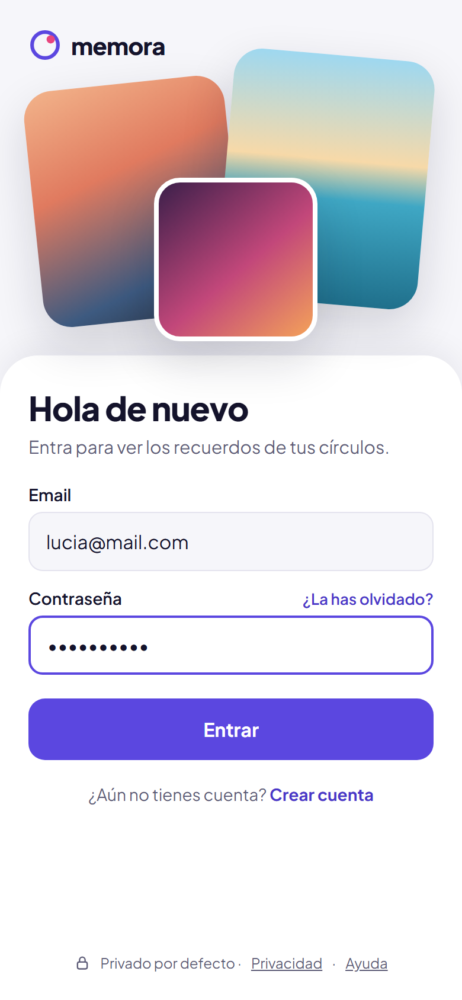 | 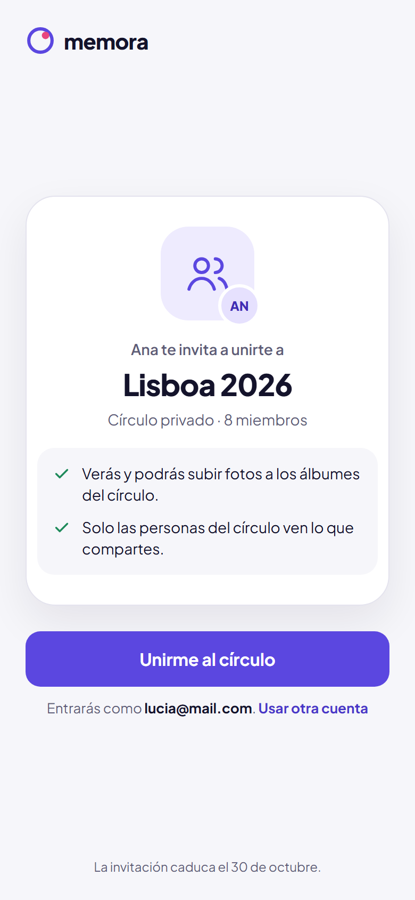 | 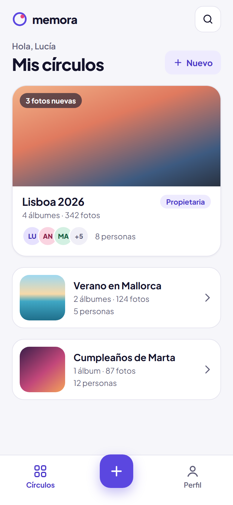 |
| **01 · Acceso** | **02 · Aceptar invitación** | **03 · Mis círculos** |
| 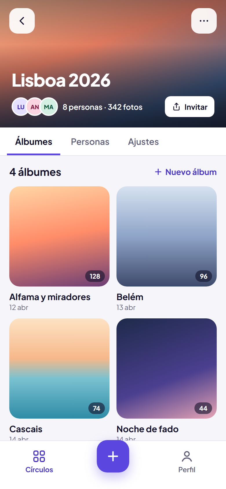 | 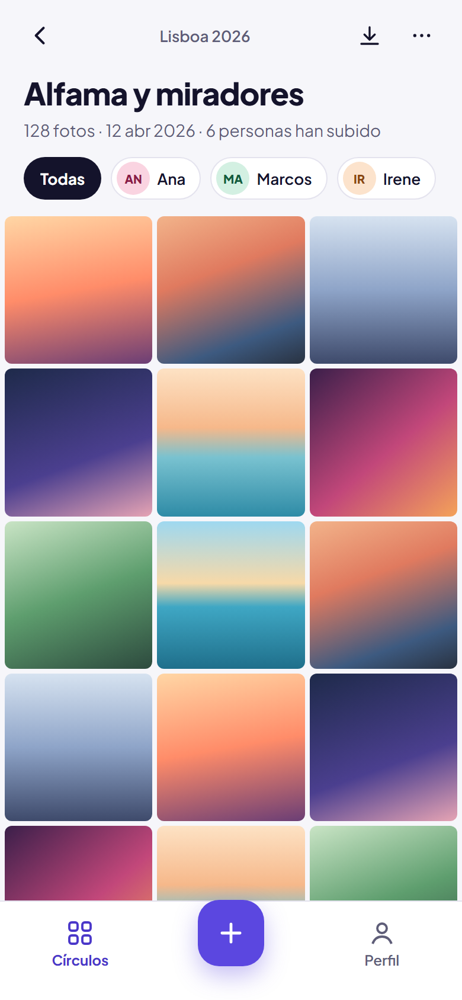 | 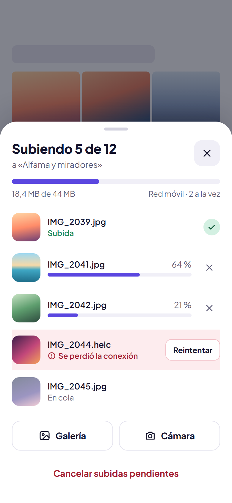 |
| **04 · Detalle de círculo** | **05 · Detalle de álbum** | **06 · Cola de subida** |
| 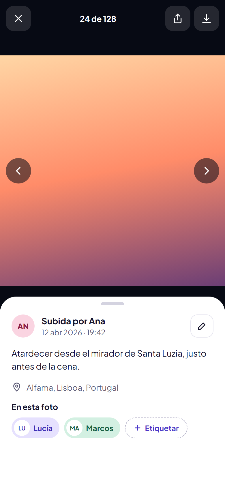 | 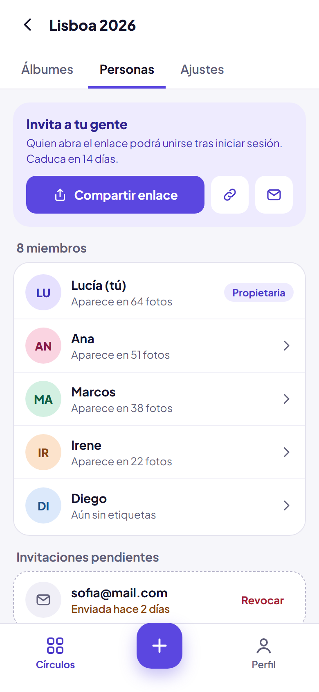 | 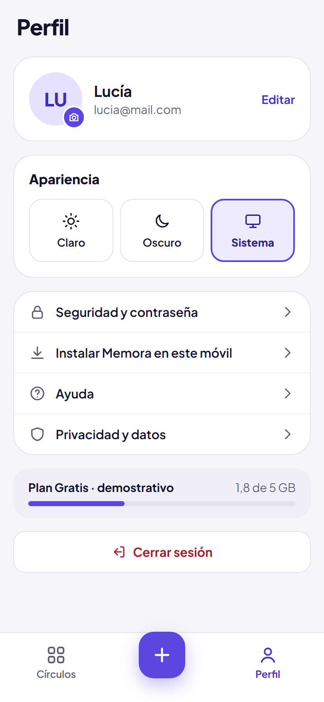 |
| **07 · Vista de foto** | **08 · Personas e invitaciones** | **09 · Perfil y preferencias** |

### 3.2 Móvil — tema oscuro

| | | |
| :---: | :---: | :---: |
| 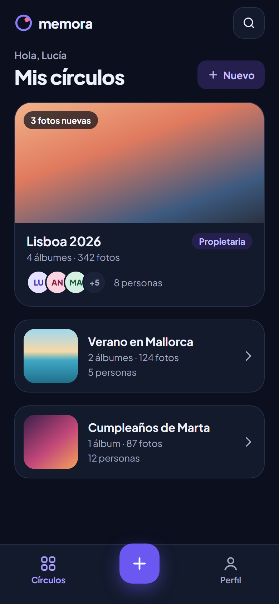 | 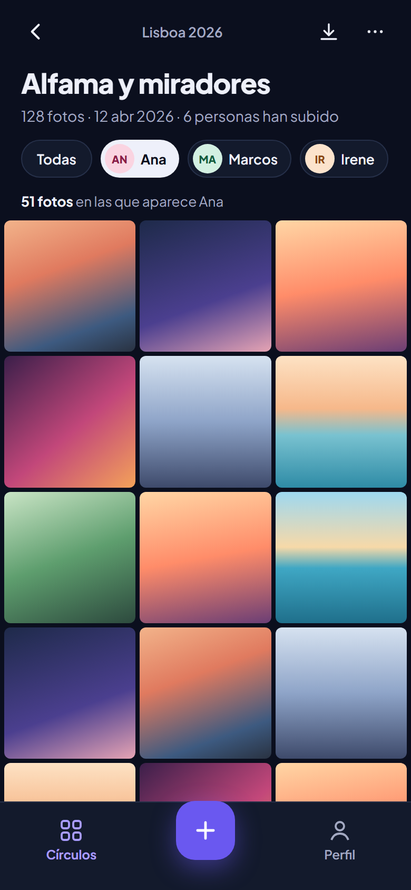 | 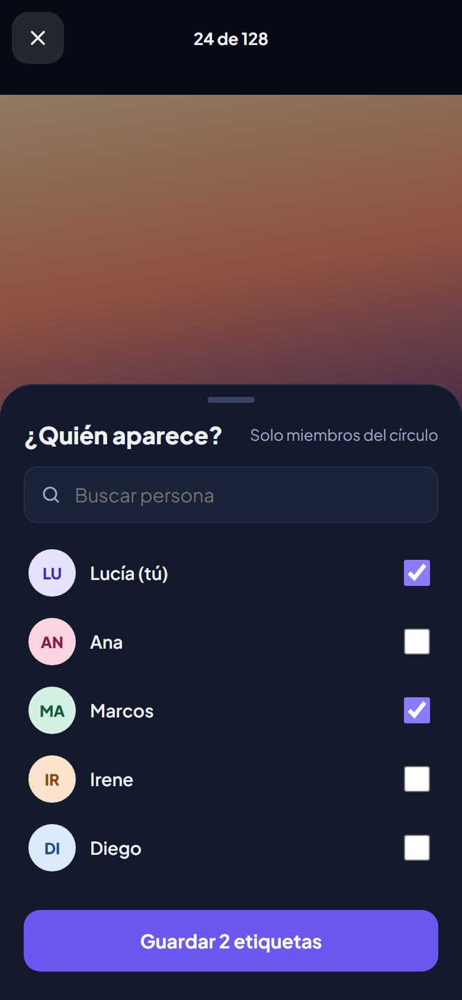 |
| **10 · Mis círculos** | **11 · Álbum filtrado por persona** | **12 · Etiquetar personas** |

### 3.3 Escritorio

**D1 · Mis círculos**

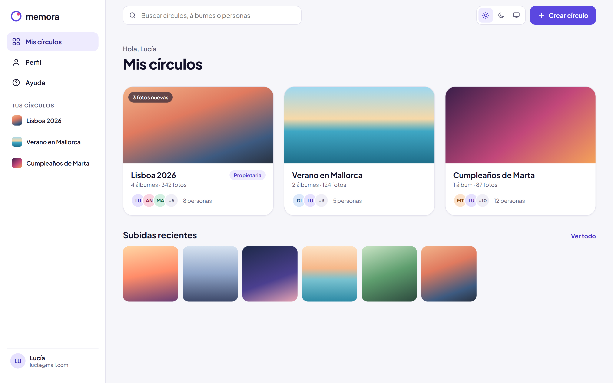

**D2 · Detalle de álbum** (selección múltiple y zona de arrastrar y soltar)

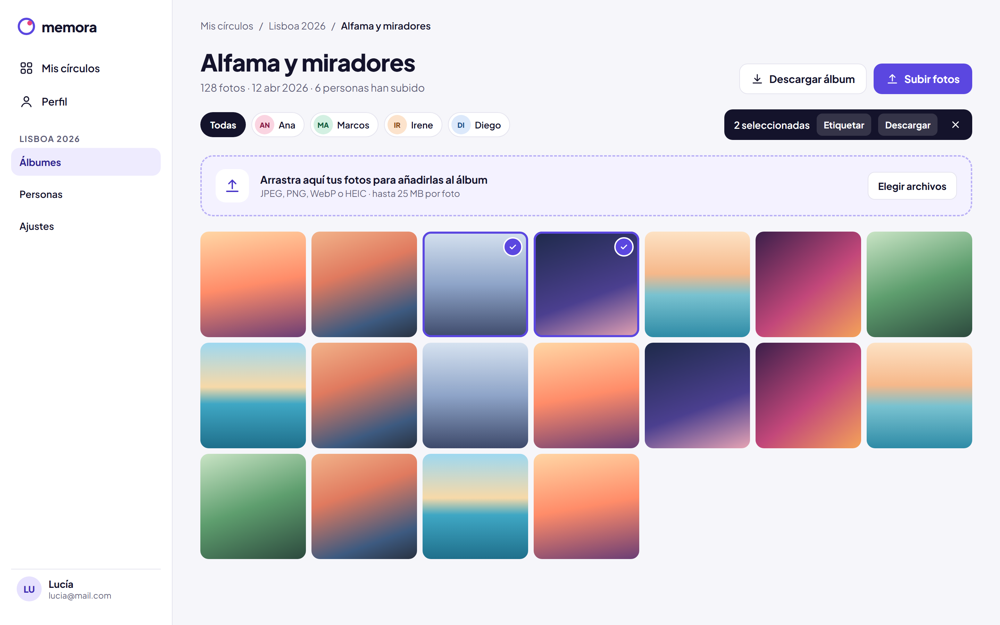

**D3 · Vista de foto** (modal con panel lateral de detalles)

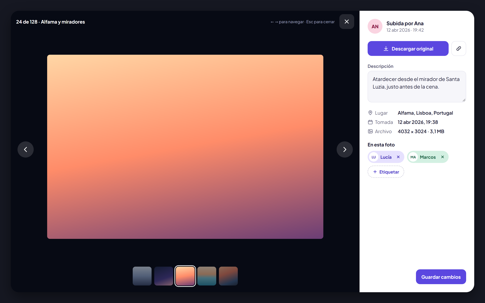

**D4 · Ajustes del círculo**

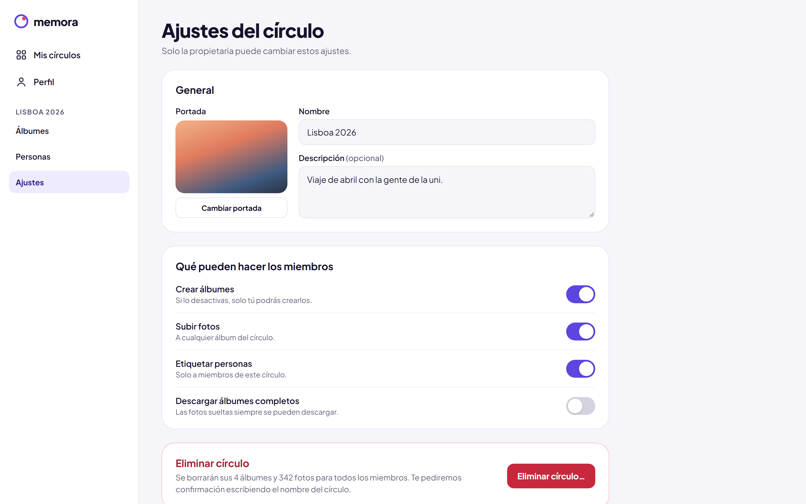

**D5 · Detalle de álbum en tema oscuro** (con panel de subidas)

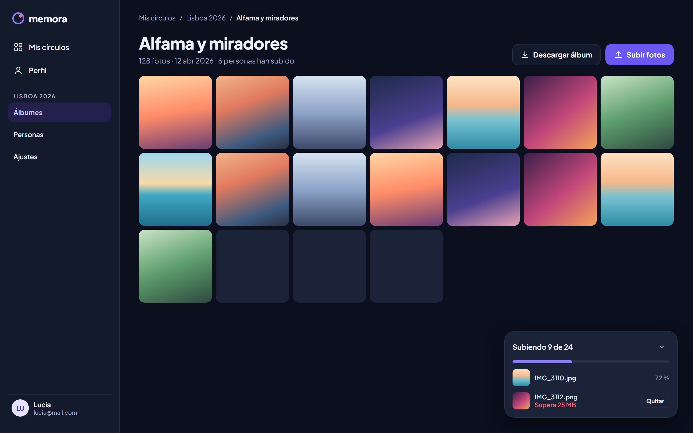

### 3.4 Hoja del sistema de diseño

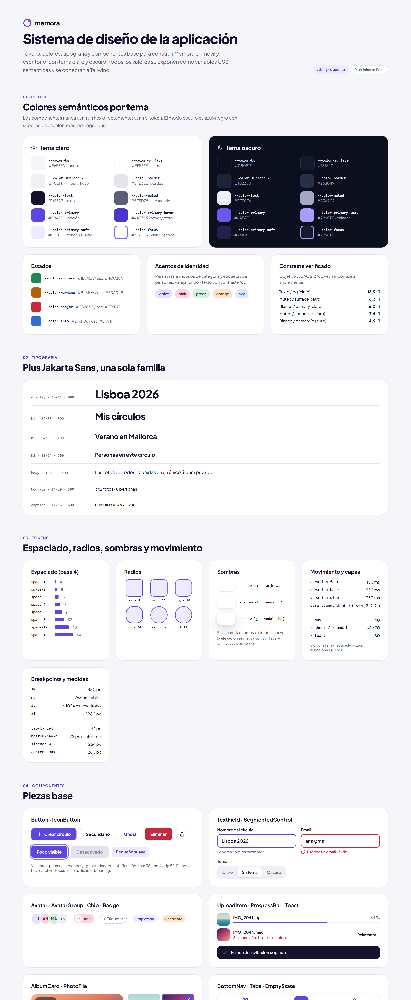

### 3.5 Pantallas sin diseño propio

Se construyen con los mismos componentes y patrones:

| Pantalla | Basarse en |
| --- | --- |
| Registro | 01 · Acceso (mismo layout, más campos) |
| Crear círculo / Crear álbum | Formularios de D4; en móvil, pantalla completa con botón de guardar fijo abajo |
| Fotos de esta persona | 11 · Álbum filtrado por persona |
| Ayuda y Privacidad | Tipografía del sistema de diseño y componente `Accordion` |
| Página no encontrada, estados vacíos, de carga y de error | Componentes `EmptyState` y `Skeleton` |

## 4. Navegación y pantallas

### 4.1 Rutas y modo de renderizado

Cada ruta usa el modo de renderizado que mejor encaja con su función, de modo que SPA, SSR y SSG aparecen en el proyecto con una razón concreta.

| Ruta | Pantalla | Renderizado | Motivo |
| --- | --- | --- | --- |
| `/` | Redirección: a `/circles` con sesión, a `/login` sin sesión | Servidor | Decidir antes de pintar nada |
| `/login`, `/register` | Acceso y registro | SSR | Carga inicial rápida en móvil |
| `/invite/:token` | Aceptar invitación | **SSR** | Etiquetas Open Graph para que el enlace muestre vista previa en WhatsApp, Telegram, etc. (solo nombre del círculo e imagen genérica) |
| `/help`, `/privacy` | Ayuda (con FAQ) y privacidad | **SSG** | Contenido editorial que no depende del usuario: se lee de Content Island en el build |
| `/circles` | Mis círculos | SPA | Contenido privado e interactivo |
| `/circles/new` | Crear círculo | SPA | |
| `/circles/:circleId` | Resumen del círculo y álbumes | SPA | |
| `/circles/:circleId/albums/new` | Crear álbum | SPA | |
| `/circles/:circleId/albums/:albumId` | Detalle de álbum (galería) | SPA | |
| `/circles/:circleId/albums/:albumId/photos/:photoId` | Vista de foto | SPA | |
| `/circles/:circleId/people` | Personas | SPA | |
| `/circles/:circleId/people/:memberId/photos` | Fotos de una persona | SPA | |
| `/circles/:circleId/settings` | Ajustes del círculo | SPA | |
| `/profile` | Perfil y preferencias | SPA | |
| `*` | Página no encontrada | SSR | |

La vista de foto tiene ruta propia para poder compartir un enlace privado. En **escritorio** se abre como modal sobre la galería; en **móvil**, a pantalla completa, y el botón «Atrás» del sistema la cierra y vuelve a la galería en la misma posición de scroll.

### 4.2 Navegación por dispositivo

| Elemento | Móvil (< 768 px) | Tablet (768–1023 px) | Escritorio (≥ 1024 px) |
| --- | --- | --- | --- |
| Navegación global | Barra inferior fija (Círculos, Subir, Perfil) | Barra inferior o rail lateral compacto | Barra lateral persistente |
| Navegación dentro del círculo | Pestañas Álbumes / Personas / Ajustes bajo la cabecera | Pestañas | Subnavegación en la barra lateral |
| Acción principal (subir / crear) | Botón central de la barra inferior, alcanzable con el pulgar | Botón en cabecera | Botón en cabecera + zona de arrastrar y soltar |
| Acciones secundarias | Hoja inferior (_bottom sheet_) | Menú desplegable | Menú desplegable o barra de herramientas |
| Selector de tema | En Perfil | En Perfil y cabecera | En cabecera y Perfil |

### 4.3 Pantallas

| Pantalla | Diseño (§3) | Contenido | Diferencias móvil / escritorio | Estados |
| --- | --- | --- | --- | --- |
| Acceso / Registro | 01 | logo, collage de fotos, formulario | Móvil: collage arriba y panel inferior. Escritorio: formulario centrado | validación, error, enviando |
| Aceptar invitación | 02 | nombre del círculo, quién invita, qué implica unirse, botón aceptar | Igual en ambos, centrado | token inválido, caducado, ya miembro |
| Mis círculos | 03, 10, D1 | saludo, nuevo círculo, tarjeta destacada, tarjetas compactas, subidas recientes (escritorio) | Móvil: una columna. Escritorio: rejilla de 2–4 columnas | sin círculos, cargando, error |
| Crear círculo | §3.5 | nombre, descripción, portada, permisos iniciales | Móvil: pantalla completa con guardar fijo abajo. Escritorio: página o diálogo | validación, éxito, error |
| Detalle de círculo | 04 | portada, miembros, botón Invitar, pestañas, rejilla de álbumes | Móvil: cabecera que se compacta al hacer scroll | sin álbumes, sin acceso |
| Detalle de álbum | 05, 11, D2, D5 | título, metadatos, filtro por persona, galería, descarga, subida | Móvil: 3 columnas. Escritorio: 4–7 columnas, arrastrar y soltar, selección múltiple | sin fotos, subiendo, error |
| Cola de subida | 06, D5 | progreso total y por archivo, reintento, origen (galería / cámara) | Móvil: hoja inferior. Escritorio: panel flotante | en cola, subiendo, subida, error, cancelada |
| Vista de foto | 07, D3 | imagen, contador, autor, descripción, lugar, fecha, etiquetas, descarga, compartir | Móvil: pantalla completa + hoja inferior. Escritorio: modal con panel lateral | cargando, imagen no disponible |
| Etiquetar personas | 12 | buscador y lista de miembros con casillas | Móvil: hoja inferior. Escritorio: diálogo desde el panel lateral | sin resultados, guardando |
| Personas | 08 | invitar, miembros con nº de fotos en que aparecen, invitaciones pendientes | Móvil: lista. Escritorio: lista con más detalle | sin etiquetas, invitación pendiente |
| Ajustes del círculo | D4 | portada, nombre, descripción, permisos, zona de peligro | Confirmaciones en hoja inferior (móvil) o diálogo (escritorio) | guardando, sin permisos |
| Perfil | 09 | datos, apariencia, ajustes, almacenamiento (demo), instalar app, cerrar sesión | — | editando, guardando, error |
| Ayuda / Privacidad | §3.5 | contenido de Content Island, índice, preguntas frecuentes en acordeón | Móvil: una columna. Escritorio: índice lateral | — |

## 5. Flujos y criterios de aceptación

### 5.1 Registro e inicio de sesión

**Flujo:** registrarse → validar datos → crear sesión → pantalla de círculos vacía con «Crear círculo». Usuario existente → iniciar sesión → recuperar sus círculos.

**Aceptación:** mensajes de error comprensibles; formularios etiquetados; validación en cliente y servidor con **el mismo esquema compartido**; no revelar si existe una cuenta; cierre de sesión efectivo; rutas privadas inaccesibles sin sesión. En móvil: `type` y `autocomplete` correctos (`email`, `current-password`, `new-password`) y el teclado virtual no tapa el botón ni los errores.

### 5.2 Crear y gestionar un círculo

**Datos:** nombre (obligatorio), descripción y portada opcionales, permisos.

**Aceptación:** solo los miembros pueden verlo; el propietario puede editarlo; estado vacío que orienta a crear el primer álbum o invitar.

### 5.3 Invitar miembros

**Flujo:** el propietario crea la invitación → en **móvil** la comparte con el menú nativo del sistema (Web Share API) o la copia; en **escritorio** la copia o la envía por email → el destinatario abre el enlace → inicia sesión o se registra sin perder la invitación → acepta → pasa a ser miembro.

**Aceptación:** token no predecible, validado en backend, con caducidad y revocación; sin uniones duplicadas; no se muestran datos privados antes de aceptar; tras el login se vuelve a la invitación; al pegar el enlace en un chat aparece la vista previa (SSR + Open Graph); si falla el email, la invitación existe igualmente y se puede copiar.

### 5.4 Álbumes

**Flujo:** crear álbum con título (obligatorio), descripción y fecha → galería → editar con permisos.

**Aceptación:** cada álbum pertenece a un círculo; estado vacío; el servidor verifica permisos al crear, editar y borrar.

### 5.5 Subir fotografías

**Flujo:** elegir archivos (móvil: galería o cámara; escritorio: selector o arrastrar y soltar) → previsualizar → validar tipo y tamaño → subir con progreso → ver en el álbum.

**Aceptación:**

- JPEG, PNG y WebP como mínimo; las fotos de iPhone pueden llegar en **HEIC/HEIF** (convertir o rechazar con mensaje claro, §12).
- Selección múltiple en ambos dispositivos; arrastrar y soltar nunca es la única vía.
- Errores por archivo con reintento individual; orientación EXIF respetada; cancelación clara.
- Pensado para **redes móviles inestables**: subidas en paralelo limitadas, progreso por archivo y global, reintento ante fallos y aviso al abandonar la pantalla con subidas en curso.
- El estado de cada archivo es una **unión discriminada** (`pending | uploading | done | error | cancelled`) gestionada por un hook propio (`useUploadQueue`) con sus tests.

### 5.6 Consultar, etiquetar y descargar

**Flujo:** abrir foto → ver autor, fecha, lugar y descripción → etiquetar solo a miembros → ver fotos de una persona → descargar foto o álbum.

**Interacción:** en **móvil**, pantalla completa, deslizar para cambiar de foto (con botones equivalentes), pellizcar para ampliar y detalles en hoja inferior. En **escritorio**, panel lateral, flechas del teclado y `Escape` para cerrar.

**Ubicación:** si la foto trae coordenadas (y la política de §12 lo permite) o el usuario indica un lugar, el **servidor** consulta el servicio de geocodificación y guarda un nombre legible («Lisboa, Portugal»). El cliente nunca llama directamente al servicio externo.

**Aceptación:** el filtro por persona solo devuelve fotos del círculo actual; descargas autenticadas; los álbumes grandes muestran progreso; nunca se filtra información de otros círculos. Verificar la descarga en **Safari iOS y Chrome Android**, donde guardar imágenes y ZIP funciona distinto (en móvil, avisar del tamaño antes de generar un ZIP).

### 5.7 Tema

**Flujo:** Claro / Oscuro / Sistema desde el perfil (y desde la cabecera en escritorio).

**Aceptación:** la preferencia persiste; «Sistema» sigue `prefers-color-scheme`; sin destello del tema incorrecto al cargar (el servidor lee la preferencia de una cookie y la aplica en el HTML); `theme-color` de la barra del navegador móvil acorde al tema.

---

# Parte II — Técnica

## 6. Stack tecnológico

### 6.1 Elecciones

| Capa | Elección | Motivo |
| --- | --- | --- |
| Monorepo | **pnpm workspaces + Turborepo** | Cubre monorepo y paquetes compartidos del temario |
| Framework web | **TanStack Start** (React + TypeScript, sobre Vite) | Ver §6.2 |
| Enrutado | TanStack Router (incluido en Start), rutas por archivos y tipadas | |
| Estilos | Tailwind CSS + PostCSS + tokens en variables CSS | |
| Datos remotos | TanStack Query | Integración nativa con los _loaders_ de Start |
| Formularios | React Hook Form + Zod | |
| API | **Node.js + Fastify** con los esquemas Zod compartidos | Rápido, tipado y con `inject` para tests sin levantar servidor |
| Base de datos | PostgreSQL + Prisma | ORM con buena documentación para quien empieza |
| Archivos | Almacenamiento compatible con S3 (MinIO en local) + `sharp` para miniaturas | |
| Servicios externos | Email (p. ej. Resend; Mailpit en local) y geocodificación (p. ej. Nominatim de OpenStreetMap, respetando su política de uso) | |
| Contenido editorial | **Content Island** (CMS headless) con su cliente `@content-island/api-client` | Visto en el curso; gestiona Ayuda, Privacidad y FAQ sin tocar código |
| Testing | Vitest, React Testing Library, MSW, Playwright, axe | |
| Calidad | ESLint, Prettier, `tsc --noEmit`, CI con Turborepo | |

Antes de empezar, comprobar las versiones estables actuales de cada herramienta y fijarlas en el `package.json`.

### 6.2 Por qué TanStack Start

- **Continuidad con lo aprendido:** está construido sobre **Vite** y es React «normal»; lo que se sabe de React, hooks y TanStack Query sirve igual.
- **Cubre más temario sin mezclar herramientas:** una sola aplicación con SPA, SSR y SSG elegidos **por ruta**, que es justo lo que necesita Memora (§4.1).
- **Tipado de punta a punta:** rutas, parámetros y _search params_ tipados.
- **Next.js no se descarta, se compara:** su modelo (App Router y React Server Components) cambia más la forma de pensar los componentes y no usa Vite. Se documenta como alternativa en un ADR, lo que también evidencia ese contenido del temario.
- **Una SPA pura** (Vite + React Router) sería más sencilla, pero dejaría fuera SSR, SSG y los metaframeworks.

**Riesgo:** TanStack Start es más joven que Next.js, con menos ejemplos y peor conocido por la IA. Mitigación: documentación oficial, prueba de concepto en el hito 1 y plan de salida (Anexo D).

## 7. Cobertura del temario

Mapa de referencia: cada contenido del temario, dónde se aplica y qué evidencia se entrega. Al final del proyecto se copia al README con enlaces a código, tests o capturas en la columna de evidencias.

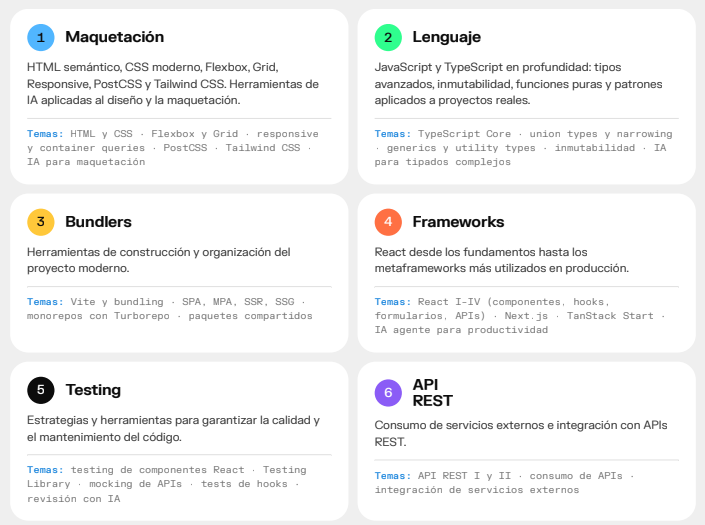

### 7.1 Maquetación

| Contenido | Aplicación en Memora | Evidencia |
| --- | --- | --- |
| HTML semántico | `header`, `nav`, `main`, `figure`/`figcaption` en fotos, `dialog` para modales, formularios con `label` y `fieldset` | Auditoría axe sin errores |
| CSS moderno | Variables CSS para tokens y temas, `clamp()`, `dvh`, `env(safe-area-inset-*)`, `:focus-visible`, `prefers-reduced-motion` | Tokens en `packages/ui` |
| Flexbox | Barras de navegación, cabeceras, listas de miembros, grupos de avatares | Componentes del _app shell_ |
| Grid | Galería de fotos, rejilla de círculos, layout de escritorio (barra lateral + contenido + panel) | Galería en 3 / 4–7 columnas |
| Responsive | _Mobile-first_ con navegación distinta por dispositivo (§4.2) | Capturas en 375 / 768 / 1440 px; E2E en ambos tamaños |
| Container queries | Tarjetas de álbum, círculo y foto que se adaptan a su contenedor (Anexo A.1) | Misma tarjeta en rejilla y en panel lateral |
| PostCSS | Pipeline de Tailwind + plugins documentados | Configuración comentada |
| Tailwind CSS | Utilidades en toda la app; tema conectado a los tokens; _preset_ compartido | Preset en `packages/ui` |
| IA para maquetación | Variantes de layout móvil/escritorio, revisión de responsive y accesibilidad a partir de capturas | Bitácora de IA |

### 7.2 Lenguaje (JavaScript y TypeScript)

| Contenido | Aplicación en Memora | Evidencia |
| --- | --- | --- |
| TypeScript core | `strict` en todo el monorepo con `tsconfig` compartido; sin `any` | `tsc` limpio en CI |
| Union types y narrowing | Estado de subida, roles (`owner \| member`), tema (`light \| dark \| system`), resultado de la API (`{ ok: true; data } \| { ok: false; error }`); `switch` exhaustivo con `assertNever` | `useUploadQueue`, cliente API |
| Genéricos | `Paginated<T>`, `ApiResult<T>`, `request<TResponse>()`, componentes genéricos (`<List<T>>`, `<Select<T>>`) | `packages/api-client`, `packages/ui` |
| Utility types | DTOs derivados del modelo: `Omit` para crear, `Partial` para editar, `Pick` para resúmenes, `Record<Role, Permission[]>` para permisos | `packages/shared` |
| Tipos inferidos de esquemas | Esquemas Zod compartidos y `z.infer<…>` como única fuente de verdad de request/response | `packages/shared` |
| Inmutabilidad | Cola de subidas y caché de TanStack Query sin mutar (spread, `map`, `filter`, `toSorted`) | Reducer de subidas |
| Funciones puras | Reglas de permisos (`can(user, action, circle)`), filtros y ordenación, formateo de fechas y tamaños | Tests unitarios sin mocks |
| IA para tipados complejos | Proponer y **revisar críticamente** los tipos del cliente REST y las uniones discriminadas | Bitácora de IA |

### 7.3 Bundlers

| Contenido | Aplicación en Memora | Evidencia |
| --- | --- | --- |
| Vite y bundling | TanStack Start sobre Vite: servidor de desarrollo, _proxy_ de `/api`, variables de entorno, _code splitting_ por ruta; `packages/ui` compilado con Vite en **modo librería**; Vitest reutiliza la configuración | `vite.config.ts` comentado; análisis del bundle |
| SPA | Rutas privadas renderizadas en cliente (§4.1) | Tabla de rutas |
| SSR | Invitación con vista previa, acceso y registro, tema sin destello | Vista previa real del enlace en un chat |
| SSG | Ayuda, Privacidad y FAQ prerenderizadas en build con el contenido de Content Island | HTML generado en el build |
| MPA | No se fuerza: un ADR explica por qué Memora es una SPA con rutas SSR/SSG y no una MPA | `docs/adr/` |
| Monorepo con Turborepo | `apps/web`, `apps/api` y paquetes compartidos; tareas `build`, `dev`, `lint`, `test`, `typecheck` con caché | `turbo.json`; CI con Turborepo |
| Paquetes compartidos | `shared`, `api-client`, `ui`, `config` (§8) | Imports `@memora/*` desde web y api |

### 7.4 Frameworks

| Contenido | Aplicación en Memora | Evidencia |
| --- | --- | --- |
| React I — componentes | Sistema de componentes en `packages/ui` y componentes de dominio por _feature_ | Anexo A |
| React II — hooks | `useUploadQueue`, `useMediaQuery`, `useTheme`, `useShare`, `useInfinitePhotos` | Tests de hooks |
| React III — formularios | React Hook Form + Zod en registro, círculo, álbum, metadatos e invitación | |
| React IV — APIs | TanStack Query: caché, paginación infinita, actualizaciones optimistas (etiquetas), invalidación | |
| Metaframework | **TanStack Start**: rutas por archivos, _loaders_, SSR/SSG por ruta | Anexo D |
| Next.js | Comparado en un ADR (enrutado, Server Components, despliegue) | `docs/adr/` |
| IA agente para productividad | Agente de código para tareas acotadas (andamiaje, migraciones, tests repetitivos), revisando cada cambio | Bitácora de IA |

### 7.5 Testing

| Contenido | Aplicación en Memora | Evidencia |
| --- | --- | --- |
| Testing de componentes React | Formularios, galería, navegación adaptativa, modal / hoja inferior, selector de tema | Vitest + React Testing Library |
| Testing Library | Consultas por rol y texto accesible, `user-event` | |
| Mocking de APIs | MSW con los esquemas de `packages/shared`, incluidos 401/403/500 y fallos de red | Handlers reutilizables |
| Tests de hooks | `renderHook` para `useUploadQueue`, `useMediaQuery`, `useTheme` | |
| Revisión con IA | Pedir casos límite que falten y revisar sus propuestas con criterio | Bitácora de IA |
| Además | E2E con Playwright en móvil y escritorio, tests de la API, accesibilidad (§9.3) | Informe de CI |

### 7.6 API REST

| Contenido | Aplicación en Memora | Evidencia |
| --- | --- | --- |
| API REST I y II | API propia (Anexo C): recursos, verbos, códigos HTTP, errores uniformes, paginación por cursor, subida de archivos, autenticación por cookie | Documentación OpenAPI o colección de peticiones |
| Consumo de APIs | `packages/api-client` tipado, usado desde la web (cliente y SSR) con TanStack Query | |
| Integración de servicios externos | Desde el **servidor**: almacenamiento S3, email de invitaciones, geocodificación; y en el build de la web, **Content Island** para el contenido editorial (Anexo B) | `.env.example`; tests con servicios simulados |

## 8. Arquitectura

```text
memora/
├── apps/
│   ├── web/                          # TanStack Start (React + Vite)
│   │   └── src/
│   │       ├── routes/               # rutas por archivos (SSR / SPA / SSG por ruta)
│   │       │   ├── __root.tsx        # documento HTML, tema, providers
│   │       │   ├── login.tsx
│   │       │   ├── invite.$token.tsx # SSR + Open Graph
│   │       │   ├── help.tsx          # prerenderizada
│   │       │   └── _app/             # layout privado (app shell) + rutas protegidas
│   │       ├── features/             # auth, circles, albums, photos, uploads, members, profile
│   │       ├── hooks/                # useUploadQueue, useMediaQuery, useTheme, useShare...
│   │       └── test/                 # setup de Vitest, handlers MSW
│   └── api/                          # Fastify: REST, auth, Prisma, S3, email, geocodificación
│       └── src/
│           ├── modules/              # auth, circles, albums, photos, invitations, downloads
│           ├── services/             # adaptadores de servicios externos
│           └── test/
├── packages/
│   ├── shared/                       # esquemas Zod, tipos derivados, reglas puras de permisos
│   ├── api-client/                   # cliente REST tipado y genérico
│   ├── ui/                           # componentes, tokens, preset de Tailwind (build con Vite)
│   └── config/                       # tsconfig base, ESLint, Prettier
├── docs/adr/                         # decisiones: TanStack Start vs Next.js, SPA vs MPA...
├── turbo.json
├── pnpm-workspace.yaml
└── README.md
```

- **Responsabilidades:** componentes presentacionales; hooks para el comportamiento; cliente API; validación compartida; lógica de dominio pura en `shared`; autorización y persistencia en el servidor; adaptadores para servicios externos (sustituibles por dobles en los tests). Ningún secreto en el cliente.
- **Móvil / escritorio en el código:** la mayor parte con CSS (media queries, container queries, utilidades de Tailwind). `useMediaQuery` solo para cambiar de **componente** (diálogo en escritorio, hoja inferior en móvil). En SSR no se conoce el tamaño de pantalla: renderizar primero la variante móvil. Nunca dos árboles de componentes duplicados.
- **Sesión:** web y API bajo el mismo dominio (la API en `/api`, con el _proxy_ de Vite en desarrollo) para usar una cookie `HttpOnly`, `Secure` y `SameSite=Lax` sin problemas de CORS.

## 9. Calidad

### 9.1 Accesibilidad (WCAG 2.2 AA)

- Estructura semántica, títulos jerárquicos, etiquetas explícitas y texto alternativo útil.
- Todo usable con teclado; foco visible, restaurado al cerrar modales y hojas, y gestionado al cambiar de ruta.
- Lectores de pantalla de escritorio y móvil (NVDA / VoiceOver, VoiceOver iOS / TalkBack).
- Contraste ≥ 4.5:1 en texto normal y ≥ 3:1 en texto grande y componentes gráficos.
- Objetivos táctiles de 44 × 44 px (mínimo WCAG 24 × 24).
- Toda acción con gestos (deslizar, pellizcar, arrastrar) tiene alternativa con un toque o botón; arrastrar y soltar siempre con selector de archivos.
- Funciona en vertical y horizontal; respeta zoom, reflow y reducción de movimiento.
- Errores con texto, no solo color; avisos de subida en regiones de estado.
- Etiquetas de personas accesibles como lista, no solo como marcas sobre la foto.

### 9.2 Privacidad y seguridad

- Almacenamiento privado, autorización por recurso en el servidor, contraseñas con hash adecuado, TLS en despliegue, cookie `HttpOnly`/`Secure`/`SameSite`, protección XSS/CSRF.
- Validación de subidas (tipo, tamaño y frecuencia); claves de servicios externos solo en el servidor; sin URLs privadas ni datos personales en logs.
- Las fotos del móvil suelen llevar **geolocalización EXIF**: decidir y comunicar antes de subir si se conserva, se muestra o se geocodifica (§12).
- La vista previa de `/invite/:token` solo muestra el nombre del círculo y una imagen genérica.
- Datos de demostración ficticios y fotos con licencia; nunca fotos privadas reales sin consentimiento.

### 9.3 Pruebas

| Nivel | Herramienta | Casos prioritarios |
| --- | --- | --- |
| Unitarias | Vitest | esquemas Zod, reglas de permisos, filtros, formatos, reducer de subidas |
| Hooks | Vitest + `renderHook` | `useUploadQueue` (reintento, cancelación, concurrencia), `useMediaQuery`, `useTheme` |
| Componentes | React Testing Library + `user-event` | formularios, navegación adaptativa, galería, modal / hoja, tema, errores; componentes de `packages/ui` aislados |
| Integración frontend | MSW | login, crear círculo, subida con fallos de red y reintento, errores 401/403/500 |
| API | Vitest + `fastify.inject` + BD de test | pertenencia, acceso cruzado, tokens, subida segura, servicios externos con dobles |
| E2E | Playwright (_Desktop Chrome_ y _Mobile Safari / Pixel_) | registro → círculo → invitación → álbum → subida → etiquetado → descarga; vista previa de la invitación |
| Dispositivos reales | iOS, Android y escritorio | subida desde galería y cámara, compartir, instalar, descargar, áreas seguras, teclado virtual |
| Accesibilidad | axe + teclado + lector de pantalla | formularios, diálogos, contraste, foco, gestos con alternativa |

**Pruebas críticas:** un miembro del círculo A no puede ver fotos del círculo B cambiando la URL; sin sesión no se descarga nada; no se etiqueta a un no miembro; un error de subida no hace perder las demás; el tema persiste sin destello; el flujo principal se completa entero en móvil; la vista previa de la invitación no expone datos privados.

### 9.4 Rendimiento

- Miniaturas y `srcset`/`sizes` para servir a cada dispositivo el tamaño que necesita; lazy loading fuera de pantalla.
- Scroll infinito en álbumes grandes, _skeletons_ sin saltos y posición de scroll conservada al volver de una foto.
- División de código por rutas y revisión del tamaño del bundle; buena puntuación en Lighthouse móvil con red y CPU limitadas.

## 10. Plan de trabajo y criterios de entrega

### 10.1 Hitos

| Hito | Entregable verificable |
| --- | --- |
| 0. Análisis | revisión de los diseños (§3) y de las pantallas pendientes (§3.5), modelo de datos, decisiones de §12 |
| 1. Base y prueba de concepto | monorepo con Turborepo y paquetes compartidos; TanStack Start con una ruta SSR, una SPA protegida y una prerenderizada; API Fastify mínima; CI |
| 2. Sistema visual | tokens del Anexo A en CSS y en el preset de Tailwind, temas sin destello, componentes de `packages/ui`, _app shell_ adaptativo, manifest instalable |
| 3. Auth y círculos | registro / login, rutas protegidas, pantalla de círculos, CRUD de círculo, permisos reales |
| 4. Colaboración | invitaciones (compartir, copiar, email, vista previa SSR), miembros, álbumes, subida y galería |
| 5. Memorias | vista de foto, etiquetas, geocodificación, fotos por persona, descargas |
| 6. Calidad | todas las pruebas de §9.3, dispositivos reales, auditoría de accesibilidad, rendimiento, seguridad |
| 7. Entrega | despliegue, README con el mapa del temario (§7), ADR, bitácora de IA, datos demo, presentación |

**Si falta tiempo:** se recortan extras y detalles visuales secundarios; nunca autorización, persistencia, flujo principal, móvil / escritorio ni pruebas esenciales. Lo que quede fuera del temario se documenta en el README.

### 10.2 Definition of Done

Una funcionalidad está terminada cuando:

- Cumple sus criterios de aceptación y tiene estados de carga, vacío, éxito y error.
- Funciona con datos persistidos y autorización en el servidor.
- Coincide con su diseño (§3) y usa solo tokens y componentes del Anexo A.
- Está revisada en móvil (táctil) y escritorio (ratón y teclado), en tema claro y oscuro, y es usable con teclado y lector de pantalla.
- Tiene tests proporcionales al riesgo, sin errores de TypeScript, lint, hidratación ni consola.
- Si aplica un contenido del temario, está anotado en el mapa de §7.

### 10.3 Checklist de entrega

- [ ] Demo desplegada con URL y credenciales de prueba.
- [ ] Flujo completo probado con dos usuarios y dos círculos, en un móvil real y en escritorio, en ambos temas; app instalada en el móvil.
- [ ] Fotos subidas (también desde el móvil), etiquetadas y descargadas de verdad; invitación enviada por enlace y por email con vista previa correcta.
- [ ] Controles de acceso verificados con pruebas negativas.
- [ ] README con instalación, scripts, variables de entorno de ejemplo y decisiones de arquitectura.
- [ ] ADR: TanStack Start frente a Next.js; SPA + SSR/SSG frente a MPA.
- [ ] Diagrama de entidades y documentación de la API.
- [ ] Tests automáticos con evidencia de ejecución en CI.
- [ ] Auditoría de accesibilidad y correcciones documentadas.
- [ ] Mapa de cobertura del temario completo, con evidencia o justificación para cada contenido.
- [ ] Bitácora de IA.
- [ ] Limitaciones conocidas y siguientes pasos.

## 11. Uso de IA

La IA forma parte del temario; cada uso deja rastro en una **bitácora** (prompt representativo, qué propuso la IA, qué se corrigió y por qué).

| Uso del temario | En Memora |
| --- | --- |
| IA para maquetación | Variantes de layout móvil / escritorio y revisión de responsive y accesibilidad a partir de capturas |
| IA para tipados complejos | Proponer y revisar el cliente REST genérico, las uniones discriminadas y los utility types |
| IA agente para productividad | Tareas acotadas (andamiaje del monorepo, Turborepo, migraciones, tests repetitivos) revisando cada cambio |
| Revisión con IA (testing) | Pedir casos límite que falten y revisar los tests propuestos |

**Herramientas de IA de Content Island:** su servidor MCP (`@content-island/mcp`) permite al asistente consultar los tipos de contenido del proyecto y crear o editar entradas, y sus _skills_ para Claude Code (`npx @content-island/ai-skills`) aportan las buenas prácticas del cliente. Útiles para generar las interfaces TypeScript de los tipos de contenido y cargar el contenido inicial de Ayuda y FAQ.

Cada sugerencia se verifica a mano y no se incorpora código que no se entienda. Con TanStack Start hay que prestar especial atención: la IA puede proponer APIs antiguas o mezclarlo con Next.js.

## 12. Decisiones pendientes

1. Qué pasa con las fotos de un miembro que sale del círculo, y cómo se le informa antes de subirlas.
2. Quién puede eliminar una foto subida por otra persona y cómo se retiran las etiquetas.
3. Si se conservan los originales y qué metadatos EXIF (sobre todo la geolocalización) se eliminan, se muestran o se geocodifican.
4. HEIC/HEIF: convertir o rechazar.
5. Tamaño máximo por archivo y cuota de almacenamiento del MVP.
6. Caducidad y revocación de invitaciones; borrado y exportación de datos.
7. Proveedores concretos de almacenamiento, email y geocodificación.
8. Content Island: definir en el proyecto los tipos de contenido de Ayuda, Privacidad y FAQ.
9. Respuestas del profesorado a las preguntas del Resumen.

---

# Anexos

## Anexo A — Sistema de diseño

### A.1 Diseño adaptativo

- **Breakpoints:** móvil 320–767 px (una columna, barra inferior), tablet 768–1023 px (2–3 columnas, barra inferior o rail), escritorio ≥ 1024 px (barra lateral, rejillas amplias, paneles laterales). Probar en 320, 375, 390, 768, 1024, 1280 y 1440 px, en vertical y horizontal, y con zoom al 200 % y 400 %.
- **Media queries** para el layout general (barra inferior o lateral, columnas de la página). **Container queries** para los componentes reutilizables (tarjetas de álbum y círculo, miniaturas), que cambian según el hueco que ocupan.
- **Móvil:** acciones principales en la mitad inferior; áreas seguras con `env(safe-area-inset-*)` y `viewport-fit=cover`; unidades `dvh`/`svh`; nada que dependa de `hover`; inputs de al menos 16 px (evita el zoom de iOS); manifest con nombre, iconos, `theme_color` y `display: standalone`.
- **Escritorio:** barra lateral persistente; galería de 4–7 columnas con selección múltiple (clic + `Shift`/`Ctrl`); arrastrar y soltar; atajos de teclado (flechas, `Escape`); estados de `hover` y foco visibles; anchura máxima en formularios y textos.

### A.2 Principios visuales

- **La fotografía manda:** interfaz neutra (grises fríos y blanco / azul-negro); el color fuerte se reserva para la acción principal (violeta) y las fotos.
- **Una sola familia tipográfica:** Plus Jakarta Sans, con jerarquía por tamaño y peso.
- **Superficies redondeadas y ligeras:** tarjetas con radio 20–24 px, bordes de 1 px y sombras suaves.
- **Oscuro ≠ negro:** fondos azul-negro y elevación marcada por superficies más claras y bordes.
- **Nunca un hex en un componente:** siempre el token semántico.
- **Movimiento discreto**, nunca necesario para entender una acción; sin animaciones con `prefers-reduced-motion`.

### A.3 Colores semánticos

| Token | Claro | Oscuro | Uso |
| --- | --- | --- | --- |
| `--color-bg` | `#F6F6FA` | `#0B0F1E` | Fondo de la aplicación |
| `--color-surface` | `#FFFFFF` | `#131A2C` | Tarjetas, barras de navegación, hojas inferiores |
| `--color-surface-2` | `#F0EFF7` | `#1B2338` | Inputs, hover, pistas de progreso, _skeletons_ |
| `--color-border` | `#E4E3EE` | `#263049` | Bordes y separadores |
| `--color-border-strong` | `#B9B7CC` | `#3A4563` | Bordes discontinuos, tirador de las hojas |
| `--color-text` | `#14132B` | `#EEF0FA` | Texto principal |
| `--color-muted` | `#5E5D78` | `#A3A9C2` | Texto secundario, metadatos |
| `--color-primary` | `#5B47E0` | `#6A58F0` | Botón principal, selección, progreso |
| `--color-primary-hover` | `#4A37C9` | `#7A69F5` | Hover / pulsado del botón principal |
| `--color-primary-text` | `#4A37C9` | `#A99CFF` | Enlaces y texto en color de acción |
| `--color-primary-soft` | `#EEEBFE` | `#241F4D` | Fondos suaves: navegación activa, insignias |
| `--color-on-primary-soft` | `#2E2390` | `#C9C0FF` | Texto sobre `primary-soft` |
| `--color-on-primary` | `#FFFFFF` | `#FFFFFF` | Texto sobre `primary` |
| `--color-focus` | `#7C6CF2` | `#A99CFF` | Anillo de foco (`:focus-visible`) |
| `--color-overlay` | `rgba(11,15,30,.5)` | `rgba(0,0,0,.6)` | Fondo detrás de modales y hojas |
| `--color-viewer-bg` | `#070A14` | `#070A14` | Visor de fotos (siempre oscuro) |
| `--color-inverse` | `#14132B` | `#EEF0FA` | Toasts, barra de selección, chip activo |
| `--color-on-inverse` | `#FFFFFF` | `#0B0F1E` | Texto sobre `inverse` |

| Estado | Claro | Oscuro | Fondo suave (claro / oscuro) |
| --- | --- | --- | --- |
| `--color-success` | `#1E8A5A` | `#4CC38A` | `#D3F0E2` / `#12332A` |
| `--color-warning` | `#B4610A` | `#F0A04B` | `#FCE3CC` / `#3A2814` |
| `--color-danger` | `#C8283C` | `#FF6B7D` | `#FDECEE` / `#3A1820` |
| `--color-danger-text` | `#A61F31` | `#FF8A98` | — |
| `--color-info` | `#2F6FD6` | `#6FA4FF` | `#DCE9FB` / `#14284A` |

**Acentos de identidad** (avatares y etiquetas de personas; asignados de forma estable, p. ej. `hash(userId) % 5`; iguales en los dos temas):

| Token | Fondo | Texto |
| --- | --- | --- |
| `--accent-violet` | `#E6E1FE` | `#3F2DB5` |
| `--accent-pink` | `#FAD4E1` | `#8A1C46` |
| `--accent-green` | `#D3F0E2` | `#145C3D` |
| `--accent-orange` | `#FCE3CC` | `#8A4510` |
| `--accent-sky` | `#DCE9FB` | `#1C4F8A` |

**Marca:** `--brand-ring` (anillo del logo) `#5B47E0` / `#8B7CFF`; `--brand-dot` (punto del logo) `#E8457E` / `#F06A9A`.

**Contrastes de referencia (aprox.):** `text` sobre `bg` claro 16,9 : 1 · `muted` sobre `surface` claro 6,3 : 1 · blanco sobre `primary` claro 6,0 : 1 · `muted` sobre `surface` oscuro 7,4 : 1 · blanco sobre `primary` oscuro 4,9 : 1. Verificar con axe al implementar.

### A.4 Tipografía

`'Plus Jakarta Sans', system-ui, sans-serif` (Google Fonts, pesos 400–800).

| Token | Tamaño / interlineado | Peso | Tracking | Uso |
| --- | --- | --- | --- | --- |
| `text-display` | 40 / 44 | 800 | -0.03em | Títulos grandes en escritorio |
| `text-h1` | 32 / 38 (móvil 26–28) | 800 | -0.02em | Título de pantalla |
| `text-h2` | 24 / 30 | 700 | -0.01em | Títulos de sección |
| `text-h3` | 18 / 24 | 700 | 0 | Títulos de tarjeta |
| `text-body` | 16 / 24 | 400 | 0 | Texto general, inputs |
| `text-body-sm` | 14 / 20 | 500 | 0 | Metadatos, botones secundarios |
| `text-caption` | 12 / 16 | 600 | 0.02em | Etiquetas, contadores, sobretítulos (mayúsculas con 0.08em) |

### A.5 Espaciado, radios, sombras y medidas

**Espaciado (base 4 px):** `space-1` 4 · `space-2` 8 · `space-3` 12 · `space-4` 16 · `space-5` 20 · `space-6` 24 · `space-8` 32 · `space-10` 40 · `space-12` 48 · `space-16` 64. Márgenes de página: 16–20 px en móvil, 40 px en escritorio.

| Radio | Valor | Uso |
| --- | --- | --- |
| `radius-sm` | 8 px | Miniaturas pequeñas, botones dentro de barras |
| `radius-md` | 12 px | Botones, inputs |
| `radius-lg` | 16 px | Miniaturas de lista, avisos |
| `radius-xl` | 24 px | Tarjetas, secciones |
| `radius-2xl` | 28–32 px | Hojas inferiores, modales |
| `radius-full` | 999 px | Avatares, chips, insignias |

| Sombra | Valor (claro) | Uso |
| --- | --- | --- |
| `shadow-sm` | `0 1px 2px rgba(20,19,43,.06), 0 1px 3px rgba(20,19,43,.08)` | Tarjetas |
| `shadow-md` | `0 4px 12px rgba(20,19,43,.08), 0 2px 4px rgba(20,19,43,.05)` | Menús |
| `shadow-lg` | `0 16px 40px rgba(20,19,43,.16), 0 4px 12px rgba(20,19,43,.08)` | Modales, hojas, panel de subidas |
| `shadow-primary` | `0 8px 20px rgba(91,71,224,.35)` | Botón central de la barra inferior |

En oscuro, solo `0 16px 40px rgba(0,0,0,.45)` en elementos flotantes.

| Medida | Valor |
| --- | --- |
| Breakpoints `sm` / `md` / `lg` / `xl` | ≥ 480 / 768 / 1024 / 1280 px |
| `tap-target` | 44 px |
| `bottom-nav-h` | 72 px + `env(safe-area-inset-bottom)` |
| `header-h` | 60–64 px (móvil) · 72 px (escritorio) |
| `sidebar-w` | 248–264 px |
| `content-max` | 1200–1280 px |
| Duraciones | 150 / 250 / 350 ms, `cubic-bezier(.2, 0, 0, 1)` |
| Capas (`z-index`) | nav 40 · hoja 60 · modal 70 · toast 80 |

### A.6 Tokens en CSS

```css
:root {
  color-scheme: light;
  --color-bg: #F6F6FA;
  --color-surface: #FFFFFF;
  --color-surface-2: #F0EFF7;
  --color-border: #E4E3EE;
  --color-border-strong: #B9B7CC;
  --color-text: #14132B;
  --color-muted: #5E5D78;
  --color-primary: #5B47E0;
  --color-primary-hover: #4A37C9;
  --color-primary-text: #4A37C9;
  --color-primary-soft: #EEEBFE;
  --color-on-primary-soft: #2E2390;
  --color-on-primary: #FFFFFF;
  --color-focus: #7C6CF2;
  --color-overlay: rgba(11, 15, 30, .5);
  --color-viewer-bg: #070A14;
  --color-inverse: #14132B;
  --color-on-inverse: #FFFFFF;
  --color-success: #1E8A5A;
  --color-warning: #B4610A;
  --color-danger: #C8283C;
  --color-danger-text: #A61F31;
  --color-info: #2F6FD6;

  --font-sans: 'Plus Jakarta Sans', system-ui, sans-serif;
  --radius-sm: 8px;
  --radius-md: 12px;
  --radius-lg: 16px;
  --radius-xl: 24px;
  --radius-2xl: 32px;
  --shadow-sm: 0 1px 2px rgba(20, 19, 43, .06), 0 1px 3px rgba(20, 19, 43, .08);
  --shadow-md: 0 4px 12px rgba(20, 19, 43, .08), 0 2px 4px rgba(20, 19, 43, .05);
  --shadow-lg: 0 16px 40px rgba(20, 19, 43, .16), 0 4px 12px rgba(20, 19, 43, .08);
  --duration-fast: 150ms;
  --duration-base: 250ms;
  --duration-slow: 350ms;
  --ease-standard: cubic-bezier(.2, 0, 0, 1);
}

:root[data-theme="dark"] {
  color-scheme: dark;
  --color-bg: #0B0F1E;
  --color-surface: #131A2C;
  --color-surface-2: #1B2338;
  --color-border: #263049;
  --color-border-strong: #3A4563;
  --color-text: #EEF0FA;
  --color-muted: #A3A9C2;
  --color-primary: #6A58F0;
  --color-primary-hover: #7A69F5;
  --color-primary-text: #A99CFF;
  --color-primary-soft: #241F4D;
  --color-on-primary-soft: #C9C0FF;
  --color-focus: #A99CFF;
  --color-overlay: rgba(0, 0, 0, .6);
  --color-inverse: #EEF0FA;
  --color-on-inverse: #0B0F1E;
  --color-success: #4CC38A;
  --color-warning: #F0A04B;
  --color-danger: #FF6B7D;
  --color-danger-text: #FF8A98;
  --color-info: #6FA4FF;
  --shadow-lg: 0 16px 40px rgba(0, 0, 0, .45);
}

@media (prefers-reduced-motion: reduce) {
  :root { --duration-fast: 0ms; --duration-base: 0ms; --duration-slow: 0ms; }
}
```

El servidor pone `data-theme` en el HTML a partir de la cookie de preferencia (§5.7); con «Sistema» se resuelve con `prefers-color-scheme`. En el preset de Tailwind de `packages/ui`, los colores, radios, sombras y fuente apuntan a estas variables (`bg: 'var(--color-bg)'`, `primary: { DEFAULT: 'var(--color-primary)', hover: …, soft: … }`), de modo que `bg-surface text-muted rounded-xl` funciona igual en los dos temas.

**Iconos:** de trazo, 24 × 24, grosor 1.8–2.2, extremos redondeados (Lucide, `lucide-react`). Tamaños 16 (chips), 18–20 (botones) y 22–24 (navegación). Decorativos con `aria-hidden="true"`; los botones que solo llevan icono, con `aria-label`.

### A.7 Componentes base (`packages/ui`)

| Componente | Variantes / props clave | Estados | Accesibilidad |
| --- | --- | --- | --- |
| `Button` | `variant`: primary · secondary · ghost · danger · soft · `size`: sm 36 · md 44 · lg 52 · `icon`, `loading`, `fullWidth` | hover, active, focus-visible, disabled, loading | `<button>` real; `aria-busy` al cargar |
| `IconButton` | `variant` (solid · outline · ghost · onMedia), `size`, `label` obligatorio | igual que `Button` | `aria-label` obligatorio por tipo |
| `LinkButton` | Variantes de `Button` renderizando `<a>` (Link del router) | — | Enlace real para navegar |
| `TextField` / `TextArea` | `label`, `hint`, `error`, `type`, `autoComplete`, `leadingIcon` | default, focus, error, disabled | `<label for>`, `aria-describedby`, `aria-invalid` |
| `SearchField` | `TextField` con lupa y botón de limpiar | vacío, con texto | label oculto visualmente |
| `Checkbox` | `label`, `description` | marcado, desmarcado, indeterminado, disabled | `<input type="checkbox">` nativo |
| `Switch` | `label`, `description` | on, off, disabled | `role="switch"` + `aria-checked` |
| `SegmentedControl` | `options`, `value` | seleccionado, foco | `radiogroup` / `radio`, flechas |
| `Tabs` | `items`, `value`, estilo subrayado | activa, hover, foco | `tablist` / `tab` / `tabpanel`, flechas |
| `Avatar` / `AvatarGroup` | `name`, `src?`, `size` (24–64), `accent`; grupo con `max` y «+N» | con imagen, con iniciales | nombre como texto alternativo |
| `Badge` | `tone`: primary · success · warning · danger · neutral | — | texto, nunca solo color |
| `Chip` | `selected`, `avatar?`, `onRemove?` | seleccionado, normal, discontinuo (añadir) | `aria-pressed` en filtros; quitar con label |
| `Card` | `padding`, `interactive` | hover, foco | un único enlace por tarjeta |
| `ProgressBar` | `value`, `size` (6 · 8), `tone` | determinado, indeterminado | `role="progressbar"` + `aria-valuenow` + label |
| `Spinner` / `Skeleton` | `size`; `shape`: rect · circle · text | animado / estático | `role="status"`; `aria-busy` en la región |
| `Toast` / `InlineAlert` | `tone`, `title`, `action?` | entra, sale | `role="status"` (`alert` en errores); icono + texto |
| `Dialog` / `ConfirmDialog` | `title`, `description`, `size`; `danger` y confirmar escribiendo el nombre | abierto, cerrando | `aria-modal`, trampa de foco, `Esc`, devuelve el foco |
| `BottomSheet` / `ResponsiveDialog` | `title`, `snapPoints`; `ResponsiveDialog` elige `Dialog` o `BottomSheet` según el tamaño | abierto, arrastrando | como `Dialog`; gesto con botón alternativo |
| `Menu` | `items`, `align` | abierto, foco | `menu` / `menuitem`, flechas, `Esc` |
| `Tooltip` | `content` | — | solo escritorio; nunca la única fuente de información |
| `EmptyState` | `icon`, `title`, `description`, `action?` | — | título como encabezado |
| `Breadcrumb` | `items` | — | `<nav aria-label="Ruta">` + `aria-current` |
| `Accordion` | `items` | abierto, cerrado | `button` + `aria-expanded` + `aria-controls` |
| `VisuallyHidden` | — | — | labels ocultos |

### A.8 Componentes de la aplicación (`apps/web`)

| Grupo | Componentes | Diseño |
| --- | --- | --- |
| Estructura | `AppShell` (elige `BottomNav` < 1024 px o `Sidebar` ≥ 1024 px y reserva áreas seguras), `BottomNav`, `Sidebar`, `TopBar`, `CircleHeader`, `ThemeToggle`, `Logo` | todas |
| `auth` | `LoginForm`, `RegisterForm`, `AuthLayout` (collage + panel) | 01 |
| `circles` | `CircleCard` (destacada y compacta), `CircleList`, `CircleForm`, `CirclePermissions`, `DangerZone` | 03, D1, D4 |
| `albums` | `AlbumCard`, `AlbumGrid`, `AlbumHeader`, `AlbumForm` | 04, 05, D2 |
| `photos` | `PhotoTile` (normal · seleccionada · cargando · no disponible), `PhotoGrid` (scroll infinito, `srcset`), `SelectionBar`, `PersonFilter`, `PhotoViewer`, `PhotoDetailsPanel`, `PhotoTags` | 05, 07, 11, D2, D3 |
| `uploads` | `UploadDropzone`, `UploadSourcePicker` (galería / cámara), `UploadQueue` (hoja en móvil, panel en escritorio), `UploadItem` | 06, D2, D5 |
| `members` | `MemberRow`, `MemberList`, `InvitePanel` (compartir / copiar / email), `PendingInvitationRow`, `TagPeopleSheet`, `InvitationCard` | 02, 08, 12 |
| `profile` | `ProfileCard`, `SettingsList`, `StorageMeter` (demo), `InstallAppRow` | 09 |

## Anexo B — Modelo de datos y servicios externos

| Entidad | Campos orientativos |
| --- | --- |
| User | id, name, email, passwordHash, avatarUrl, themePreference, createdAt |
| Session | id, userId, expiresAt, createdAt |
| Circle | id, ownerId, name, description, coverPhotoId, settings, createdAt |
| Membership | id, circleId, userId, role, joinedAt |
| Invitation | id, circleId, tokenHash, invitedEmail?, emailSentAt?, expiresAt, acceptedAt, revokedAt |
| Album | id, circleId, title, description, date?, coverPhotoId?, createdBy, createdAt |
| Photo | id, circleId, albumId, uploaderId, objectKey, mimeType, size, width, height, takenAt?, latitude?, longitude?, placeName?, description?, createdAt |
| PhotoTag | id, photoId, taggedUserId, createdBy, createdAt |
| DownloadJob | id, albumId, requestedBy, status, objectKey?, createdAt, expiresAt |

Claves foráneas e índices para buscar por círculo, álbum y persona etiquetada. El `circleId` de la foto permite comprobar la pertenencia, coherente con el de su álbum. No exponer `objectKey` ni tokens de invitación. Guardar varios tamaños de cada imagen (miniatura, pantalla y original).

| Servicio | Para qué | Cómo se integra | Si falla |
| --- | --- | --- | --- |
| Almacenamiento S3 | Originales, miniaturas y ZIP | SDK de S3 desde la API; URLs firmadas de corta duración | Error claro en la subida y reintento |
| Email | Enviar invitaciones | Llamada HTTP desde la API al crear la invitación | La invitación existe igualmente y se puede copiar |
| Geocodificación | Coordenadas o texto → nombre de lugar | Llamada HTTP desde la API, con caché y límite de frecuencia | La foto se guarda sin nombre de lugar |
| Content Island | Contenido editorial: Ayuda, Privacidad y FAQ | Cliente `@content-island/api-client` desde `apps/web`, solo en el build (SSG); token de **lectura** que nunca llega al navegador | El build falla con un mensaje claro; no se publica una página vacía |

**Content Island** (CMS headless de Lemoncode) se usa solo para contenido editorial, que se escribe desde su panel y la app solo lee. Los datos que crean los usuarios (cuentas, círculos, fotos, etiquetas, permisos) viven en PostgreSQL, porque necesitan escrituras desde la app y autorización por usuario.

- **Cliente:** `createClient({ accessToken })` con un **token de lectura** (el de escritura solo hace falta para crear o editar contenido, y no se usa en la app). Lecturas tipadas con genéricos: `getContentList<FaqItem>({ contentType: 'faqItem', language: 'es' })` y `getContent<LegalPage>({ 'fields.slug': 'privacidad', language: 'es' })`.
- **Modo snapshot para el SSG:** `npx content-island export --access-token <token>` genera `content-island-snapshot.json` antes del build, y el cliente con `mode: 'snapshot'` lee de ese archivo sin llamadas de red. El build es más rápido y reproducible.
- **Tipos de contenido previstos:** `helpArticle` (título, slug, cuerpo, orden), `faqItem` (pregunta, respuesta, categoría, orden) y `legalPage` (título, slug, cuerpo, fecha de actualización), con sus interfaces TypeScript en `packages/shared`.
- **Contenido multilingüe** de serie (`language`), útil si más adelante se traduce la app.
- **Actualizar textos:** cambiar el contenido en Content Island y volver a generar el snapshot y el build.

Claves en variables de entorno de la API con `.env.example` documentado; en los tests, dobles a través de los adaptadores de `services/`.

## Anexo C — API REST

```http
POST   /api/auth/register
POST   /api/auth/login
POST   /api/auth/logout
GET    /api/me
PATCH  /api/me
GET    /api/circles
POST   /api/circles
GET    /api/circles/:circleId
PATCH  /api/circles/:circleId
DELETE /api/circles/:circleId
GET    /api/circles/:circleId/members
DELETE /api/circles/:circleId/members/:userId
POST   /api/circles/:circleId/invitations
GET    /api/invitations/:token
POST   /api/invitations/:token/accept
GET    /api/circles/:circleId/albums
POST   /api/circles/:circleId/albums
GET    /api/albums/:albumId
PATCH  /api/albums/:albumId
GET    /api/albums/:albumId/photos?cursor=...
POST   /api/albums/:albumId/photos
GET    /api/photos/:photoId
PATCH  /api/photos/:photoId
GET    /api/photos/:photoId/image?size=thumb|display|original
POST   /api/photos/:photoId/tags
DELETE /api/photos/:photoId/tags/:userId
GET    /api/circles/:circleId/members/:userId/photos
GET    /api/photos/:photoId/download
POST   /api/albums/:albumId/downloads
GET    /api/downloads/:jobId
```

- Contratos definidos **una sola vez** con Zod en `packages/shared`: la API los usa para validar y la web para tipos y formularios.
- Errores uniformes (`code`, `message`, `details?`) y códigos HTTP correctos.
- Paginación por cursor (scroll infinito); nunca todas las fotos de un círculo en una respuesta.
- Límites de tamaño y cantidad; descargas con URL firmada de corta duración o streaming autenticado.
- `GET /api/invitations/:token` solo devuelve lo mínimo para mostrar la invitación (nombre del círculo, quién invita).
- Documentación con OpenAPI o una colección de peticiones.

## Anexo D — Guía de TanStack Start

TanStack Start **no sustituye a React**: es React más una capa de enrutado, carga de datos y servidor. Lo nuevo:

| Concepto | Qué es | Dificultad | Dónde se usa |
| --- | --- | --- | --- |
| Rutas por archivos | Cada archivo de `src/routes/` es una ruta; `$circleId` es un parámetro | Baja | Todas las pantallas |
| Layouts anidados | Una ruta padre envuelve a sus hijas con `<Outlet />` | Baja | _App shell_, cabecera del círculo |
| _Loaders_ | Cargan datos **antes** de pintar, en servidor o en cliente | Media | Precargar círculo y álbumes con TanStack Query |
| `beforeLoad` | Comprobar la sesión y redirigir a `/login` | Media | Rutas privadas |
| SSR, SPA y SSG por ruta | Elegir dónde se renderiza cada ruta | Media | §4.1 |
| Código solo de servidor | Funciones de servidor y variables de entorno privadas | Media-alta | Reenviar la cookie a la API en SSR; Open Graph |
| Hidratación | Servidor y cliente deben pintar lo mismo | Media-alta | Tema sin destello; fechas con zona horaria fija |

1. Empezar por el tutorial oficial y una prueba de 3 rutas: pública con SSR, privada protegida con `beforeLoad` y prerenderizada.
2. Los datos viven en la **API REST** y en `packages/api-client`. Las funciones de servidor de Start solo se usan para lo que necesita el servidor web (cookie en SSR, Open Graph), nunca para sustituir la API.
3. Componentes y hooks son React puro, sin dependencia de Start, y se prueban sin el framework.
4. Ante errores de hidratación, revisar primero el uso de `window`, fechas y valores aleatorios.
5. **Plan de salida:** si Start bloquea el avance, las rutas privadas pasan a SPA pura; componentes, hooks, API y paquetes no cambian.

## Anexo E — Forma de trabajo con el agente de código

El proyecto se construye **paso a paso y en colaboración con un agente de IA**, no generándolo de golpe. El objetivo es aprender cómo se construye cada parte, tomar las decisiones y entender todo el código que se entrega. Estas directrices son de obligado cumplimiento para el agente.

### E.1 Reglas de trabajo

1. **Nunca construir la aplicación entera ni un hito completo de una vez.** Cada petición se resuelve como un paso pequeño y revisable (una pantalla, un componente, un endpoint, una configuración).
2. **Proponer antes de hacer.** Antes de escribir código, explicar en pocas líneas qué se va a hacer, en qué archivos y por qué. Esperar mi confirmación.
3. **Las decisiones son mías.** Cuando haya varias opciones razonables (librería, estructura, nombre, patrón), presentarlas con sus ventajas e inconvenientes y una recomendación, y esperar a que elija. No decidir en silencio.
4. **Explicar lo que se hace.** Al terminar cada paso, resumir qué se ha hecho y por qué funciona, señalando los conceptos nuevos (sobre todo de TanStack Start, Turborepo, MSW o Fastify, que aún no domino) y qué tema del temario se está aplicando.
5. **Pararse al terminar cada paso.** No encadenar el siguiente paso sin que lo pida. Al final, sugerir cuál podría ser el siguiente.
6. **Pedir permiso para lo que no es código del paso:** instalar dependencias, crear o borrar archivos fuera de lo acordado, cambiar configuración, ejecutar migraciones, hacer commits o publicar.
7. **Respetar este documento.** Seguir el diseño (§3), los tokens y componentes (Anexo A), las rutas (§4.1), la arquitectura (§8), el stack (§6) y la Definition of Done (§10.2). Si algo del documento no encaja o falta, avisar y proponer el cambio en lugar de improvisar.
8. **Si algo no se ha visto en clase o es reciente** (TanStack Start), consultar la documentación oficial antes de escribir código y decirlo si no se está seguro.
9. **Tests y verificación junto al código.** Cada paso incluye sus pruebas cuando aplique (§9.3) y se comprueba que funciona antes de darlo por terminado, contando el resultado tal cual (también si algo falla).
10. **Apoyar la bitácora de IA (§11).** Cuando se corrija algo propuesto por la IA o se tome una decisión relevante, señalarlo para que pueda anotarlo.

### E.2 Contexto del proyecto para el agente

> Memora es una aplicación web real (no una maqueta) para móvil y escritorio, en un **monorepo con Turborepo** (`apps/web` con **TanStack Start**, `apps/api` con **Fastify**, y paquetes `shared`, `api-client`, `ui` y `config`). Las pantallas se construyen a partir de los diseños de §3 (imágenes en `assets/design/`) con los tokens y componentes del Anexo A, sin valores de color o tamaño sueltos; las pantallas sin diseño siguen §3.5. Diseño _mobile-first_, igual de usable en móvil (táctil, barra inferior, subida desde galería o cámara, instalable) y en escritorio (barra lateral, arrastrar y soltar, atajos de teclado). Renderizado de cada ruta según §4.1. Datos en la API REST propia (Anexo C) con esquemas Zod compartidos y permisos por círculo en el servidor; S3, email y geocodificación desde el servidor; Ayuda, Privacidad y FAQ desde Content Island en el build (Anexo B). Cada tecnología debe resolver un problema real y quedar anotada en el mapa del temario (§7). El orden de trabajo sigue los hitos de §10, siempre con las reglas de E.1.
