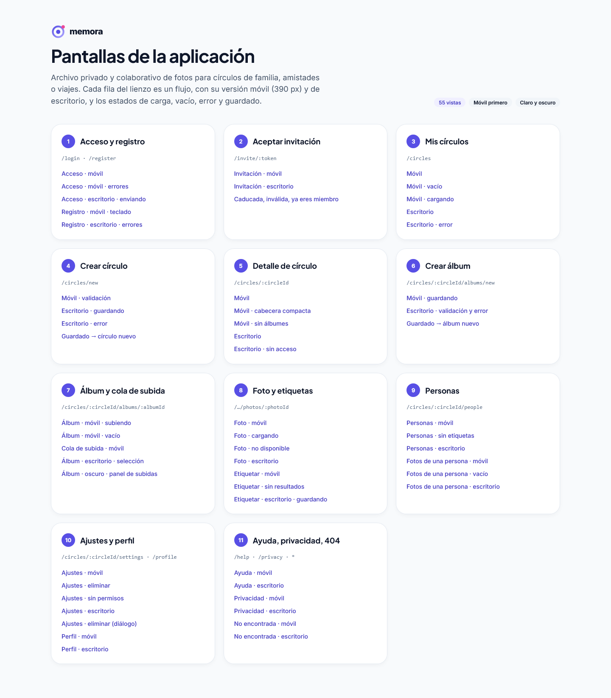

# Memora

> **Todos vuestros recuerdos, por fin, en el mismo lugar.**

[](https://github.com/Luceir0/lab-final--memora/actions/workflows/ci.yml)

Memora es una aplicación web **privada y colaborativa** para reunir los recuerdos fotográficos de un grupo de confianza. Cada **círculo** comparte álbumes, etiqueta a quién aparece en cada foto y descarga lo que necesite. No hay perfiles públicos, seguidores, likes ni contenido abierto: no es una red social.

Este repositorio contiene la **entrega del trabajo final del curso de Frontend con IA**: la primera iteración del producto, funcionando de extremo a extremo, junto con su documentación, sus decisiones de arquitectura y la evidencia de su verificación.

Misma calidad en **móvil y escritorio**, tema **claro, oscuro y sistema**, PWA instalable, **API REST propia**, PostgreSQL y almacenamiento de objetos privado.

---

## Estado de la entrega

| | |
| --- | --- |
| Versión | **0.1** — primera iteración |
| Entrega | Trabajo final del curso · noviembre de 2026 |
| Producto | MVP completo y verificado de extremo a extremo en local |
| Especificaciones | **36 cerradas**, 4 en revisión final y 4 trasladadas a la siguiente iteración |
| Verificación | **1.815 tests**, CI en verde, axe sin violaciones e informe de seguridad |
| Despliegue | Entorno local reproducible; guía de despliegue escrita, sin cloud |

El MVP está cerrado y probado. Las cuatro especificaciones en revisión final son las de calidad y entrega —rendimiento (F40), seguridad (F41), despliegue (F42) y paquete de entrega y defensa (F43)—: su trabajo y su evidencia están hechos y solo les queda la aceptación. Las cuatro que pasan a la siguiente iteración son **actividad del círculo** (F35), **infraestructura de tests** (F37), **E2E de flujos críticos** (F38) y **auditoría formal de accesibilidad** (F39).

El estado real, feature a feature, con su nivel de auditoría y su evidencia, está en el **[tablero de features](docs/04-features/README.md)**.

---

## Qué hace hoy

- **Cuenta y acceso.** Registro, inicio y cierre de sesión, sesión persistente en base de datos, cookies `HttpOnly`, protección CSRF y límite de intentos.
- **Círculos.** Creación, listado con destacado, detalle, ajustes y permisos por rol; salir del círculo y eliminarlo con confirmación.
- **Invitaciones.** Enlace con token hasheado y caducidad de 7 días, envío de email opcional y página pública de invitación con Open Graph y aceptación real.
- **Personas.** Miembros del círculo, invitaciones pendientes, expulsión, salida y «Fotos de esta persona».
- **Álbumes.** Alta, edición, vaciado y borrado, con portada elegida entre las fotos del álbum y permisos por círculo.
- **Subidas.** Cola global con arrastrar y soltar, cámara y galería, progreso, reintento, cancelación y hasta tres subidas simultáneas. El servidor valida por *magic bytes*, procesa con `sharp`, extrae el lugar y aplica cuotas.
- **Galería y visor.** Scroll infinito, selección múltiple, filtro por persona, visor a pantalla completa en móvil y en modal en escritorio, con navegación por teclado y gestos.
- **Metadatos y etiquetas.** Edición de descripción, fecha y lugar; etiquetado de personas con búsqueda y actualización optimista.
- **Descargas.** Foto individual, selección y álbum completo en ZIP, con trabajo asíncrono, progreso, límites y expiración.
- **Perfil, tema y PWA.** Nombre editable, email de solo lectura, avatar con iniciales, tema claro/oscuro/sistema e instalación en la pantalla de inicio.
- **Contenido.** Ayuda, preguntas frecuentes y política de privacidad generadas en el build desde Content Island.

Todo se apoya en una **API REST propia** con autorización en servidor, paginación por cursor, subida multipart y entrega privada de imágenes.

---

## Los seis módulos del curso

El proyecto cubre los seis bloques del temario. Esta tabla resume dónde se aplica cada uno; el detalle tema a tema, con su evidencia y su estado, está en el **[mapa de cobertura](docs/07-curriculum/coverage-map.md)**.

| Módulo | Dónde se aplica en Memora | Evidencia |
| --- | --- | --- |
| **1. Maquetación**<br>HTML semántico, CSS moderno, Flexbox y Grid, responsive, Tailwind | HTML semántico con landmarks, `nav`, `main` y encabezados únicos; variables CSS, `100dvh`, `:has()`, `focus-visible`, `prefers-reduced-motion` y safe areas; Flexbox y Grid en el shell, círculos, álbumes y galería; responsive de 320 a 1440 px; tokens de diseño y Tailwind 4 CSS-first, sin colores fuera de escala. *Las container queries no se usan: el responsive se resuelve con breakpoints.* | [Tokens](docs/02-design/tokens.md) · [Componentes](docs/02-design/components.md) · [Pantallas](docs/02-design/screens.md) |
| **2. Lenguaje**<br>TypeScript, union types, genéricos, inmutabilidad, funciones puras | TypeScript estricto sin `any` (`noUncheckedIndexedAccess`, `exactOptionalPropertyTypes`); uniones discriminadas en roles, errores, tema y estados de la cola de subida; genéricos en `Page<T>`, `ApiResult<T>` y `request<T>`; tipos inferidos de Zod; permisos y paginación como funciones puras e inmutables. | [`tsconfig` base](packages/config/tsconfig/base.json) · [`permissions.ts`](packages/shared/src/permissions.ts) · [`pagination.ts`](packages/shared/src/pagination.ts) |
| **3. Bundlers**<br>Vite, SPA, SSR, SSG, monorepos, paquetes compartidos | Vite 8 con TanStack Start; SPA en las rutas privadas, SSR en acceso, registro e invitación y SSG en ayuda y privacidad; code-splitting por ruta, proxy `/api` y variables por entorno; monorepo con pnpm y Turborepo y paquetes compartidos. *MPA no se fuerza: la decisión está razonada en el ADR-0002.* | [ADR-0002](docs/03-architecture/adr/ADR-0002-render-modes.md) · [`vite.config.ts`](apps/web/vite.config.ts) · [`turbo.json`](turbo.json) |
| **4. Frameworks**<br>React, hooks, formularios, APIs, metaframeworks | React 19 con componentes presentacionales en `@memora/ui`; TanStack Start, Router y Query; hooks propios para tema, cola de subida, medios y foco; formularios con React Hook Form y los mismos esquemas Zod que valida la API. *Next.js se valoró y se descartó en el ADR-0001.* | [ADR-0001](docs/03-architecture/adr/ADR-0001-metaframework.md) · [`packages/ui`](packages/ui) · [`apps/web/src/features`](apps/web/src/features) |
| **5. Testing**<br>Componentes, Testing Library, mocking, hooks, revisión con IA | Vitest en los cinco paquetes; Testing Library por rol y nombre accesible; MSW 3 para `fetch` y XHR; tests de hooks montados en su provider; integración real contra PostgreSQL y contra Silo; axe en jsdom y en navegador sobre el build. | [Estrategia de tests](docs/05-quality/strategy.md) · [Matriz de tests](docs/05-quality/test-matrix.md) · [Informe de accesibilidad](docs/05-quality/a11y-report.json) |
| **6. API REST**<br>API REST I y II, consumo de APIs, servicios externos | Fastify 5 con contratos Zod y OpenAPI de 29 rutas; sesiones en base de datos, CSRF con HMAC, comprobación de `Origin` y rate limit; autorización por recurso en cada endpoint; paginación keyset; subida multipart con S3, email con Mailpit o Resend y geocodificación con Nominatim. La web consume todo con un cliente HTTP tipado. | [Contrato REST](docs/03-architecture/api-contract.md) · [`apps/api/src/modules`](apps/api/src/modules) · [`packages/api-client`](packages/api-client) |

---

## Stack

| Capa | Elección |
| --- | --- |
| Monorepo | pnpm 10.34.8 + Turborepo 2.11.10 |
| Web | React 19.3.1 + **TanStack Start 1.169.4** sobre Vite 8.3.5 |
| Estilos | **Tailwind CSS 4.3.3** (CSS-first, `@theme`) + tokens en variables CSS |
| Datos remotos | TanStack Query 5.105.1 |
| Formularios | React Hook Form 7.91 + Zod 4.6.7 |
| Contratos compartidos | `@memora/shared`: Zod, errores, paginación y permisos puros |
| API | Node.js 24 + **Fastify 5.12.7** |
| Base de datos | PostgreSQL 17 + **Prisma 7.10.1** |
| Archivos | S3-compatible (Silo en local; R2 o AWS en producción) + `sharp` 0.35.5 |
| Email | Mailpit local / Resend opcional |
| Geocodificación | Nominatim (OpenStreetMap) |
| Contenido editorial | **Content Island** (Ayuda, FAQ y Privacidad) |
| Testing | Vitest 5, React Testing Library, MSW 3 y axe 4.14 |
| Calidad | TypeScript 6.0.3 estricto, ESLint, Prettier y GitHub Actions |

Las versiones están fijadas y verificadas contra los manifiestos; el inventario completo, con qué aporta cada dependencia y por qué está, está en el **[dossier técnico](docs/08-delivery/technical-dossier.md)**.

---

## Arquitectura

Dos procesos desplegables, una sola fuente de verdad para los contratos y autorización siempre en el servidor:

```text
Navegador
  │  HTTPS · cookie HttpOnly
  ▼
apps/web (TanStack Start + Node) ─── Content Island (snapshot en el build)
  │  /api (proxy en desarrollo, mismo dominio en producción)
  ▼
apps/api (Fastify)
  ├── PostgreSQL (Prisma)
  ├── S3-compatible (Silo / R2 / S3)
  ├── Email (Mailpit / Resend)
  └── Geocodificación (Nominatim)
```

- La web **no** habla con la base de datos ni con el bucket: todo pasa por la API.
- `packages/shared` define una vez los esquemas, los DTO, los errores y los permisos; web y API comparten ese contrato.
- La autorización se decide en cada recurso, no en la interfaz. La UI refleja permisos; la API los impone.
- Privacidad por defecto: bucket privado, sin coordenadas GPS persistidas y sin PII en los logs.

Detalle y límites de cada capa en [arquitectura](docs/03-architecture/overview.md) y en los **14 ADR** de [docs/03-architecture/adr](docs/03-architecture/adr).

---

## Estructura del repositorio

```text
memora/
├── AGENTS.md                    # constitución del proyecto para agentes
├── opencode.jsonc               # configuración de OpenCode V2
├── CLAUDE.md                    # puente para Claude Code
├── .opencode/                   # agentes, comandos y skills
├── .github/workflows/           # CI: docs, agents, lint, typecheck, test y build
├── apps/
│   ├── web/                     # TanStack Start sobre Vite
│   └── api/                     # Fastify, Prisma y pipeline de subidas
├── packages/
│   ├── shared/                  # Zod, DTO, errores, paginación y permisos
│   ├── api-client/              # cliente HTTP tipado
│   ├── ui/                      # sistema de diseño y componentes
│   └── config/                  # tsconfig, ESLint y Prettier compartidos
├── scripts/                     # check-docs, validate-agents e iconos
├── docker-compose.yml           # PostgreSQL, Silo (S3) y Mailpit locales
├── content-island-snapshot.json # contenido editorial para el build
├── assets/
│   ├── design/                  # diseños canónicos normalizados
│   ├── archive/design-v1/       # primera iteración (histórico)
│   └── demo/                    # fotos de demostración con licencia
└── docs/
    ├── 01-product/              # visión, alcance, personas y glosario
    ├── 02-design/               # tokens, componentes y pantallas
    ├── 03-architecture/         # overview, contratos, ADR y subidas
    ├── 04-features/             # 44 specs con criterios de aceptación
    ├── 05-quality/              # DoD, estrategia, informes y auditorías
    ├── 06-process/              # workflow, protocolo de agentes y bitácora
    ├── 07-curriculum/           # cobertura del temario
    └── 08-delivery/             # demo, despliegue, defensa y dossier
```

---

## Puesta en marcha

Requisitos: **Node 24**, **pnpm 10.34.8** (vía corepack) y **Docker Desktop**.

```bash
docker compose up -d        # PostgreSQL, Silo (S3) y Mailpit
pnpm install

# Exporta en esta shell las variables de .env.example
# (ningún proceso carga el .env de la raíz; hay snippets para
# Git Bash y PowerShell en la guía de despliegue)
pnpm db:migrate
pnpm db:seed                # datos deterministas e idempotentes
pnpm db:seed:images         # escribe las imágenes del seed en Silo
pnpm dev                    # API en :3001 y web en :3000
```

La primera vez hay que crear el bucket privado:

```bash
docker compose exec -T minio mc alias set local http://127.0.0.1:9000 memora memora123
docker compose exec -T minio mc mb --ignore-existing local/memora
```

Usuarios de demostración que crea el seed:

| Usuario | Email | Contraseña | Rol |
| --- | --- | --- | --- |
| Lucía Ferrer | `lucia@memora.test` | `memora-demo` | `owner` de los dos círculos |
| Mateo Ríos | `mateo@memora.test` | `memora-demo` | `member` de los dos círculos |

Mailpit queda en `http://localhost:8025` para ver los emails de invitación y la consola de Silo en `http://localhost:9001`.

La guía completa —variables, healthchecks, migraciones, seed, solución de problemas y despliegue— está en **[deployment.md](docs/08-delivery/deployment.md)**.

### Scripts

| Comando | Qué hace |
| --- | --- |
| `pnpm dev` | API y web en modo desarrollo |
| `pnpm build` | Build de producción de todos los paquetes |
| `pnpm lint` | ESLint en raíz y workspaces |
| `pnpm typecheck` | `tsc --noEmit` en los nueve proyectos |
| `pnpm test` | Vitest en todos los paquetes |
| `pnpm format:check` | Comprueba el formato de código |
| `pnpm docs:check` | Valida enlaces y estructura documental |
| `pnpm agents:check` | Valida agentes, comandos, skills y las 44 specs |
| `pnpm db:migrate` / `pnpm db:seed` / `pnpm db:seed:images` | Base de datos y datos de demo |

---

## Verificación y calidad

- **1.815 tests** en verde: API **429** (+2 de integración omitidos por diseño sin base), web **910** en 110 archivos, `shared` **154**, `ui` **283** y `api-client` **39**.
- **Integración real** con PostgreSQL 17 y con Silo para las suites que lo necesitan, sin mocks de base de datos.
- **CI en GitHub Actions** con instalación, validación documental y de agentes, lint, typecheck, tests y build.
- **Accesibilidad:** 16 pasadas de axe sobre el build de producción, en móvil y escritorio, claro y oscuro, con **0 violaciones**; además, axe en jsdom dentro de los tests de componentes.
- **Rendimiento:** Lighthouse móvil con Performance 93/91, Accesibilidad 100/100 y Buenas prácticas 100/100; CLS 0 y 0,004. El LCP en simulación queda por encima del presupuesto y se declara en las limitaciones.
- **Seguridad:** revisión con casos negativos reales de autenticación, CSRF, `Origin`, rate limit, acceso cruzado, descarga, subida y borrado. Sin bloqueantes abiertos.
- **Privacidad EXIF:** el GPS se usa solo en memoria para resolver el lugar y nunca se persiste ni se registra; los metadatos se eliminan de los archivos servidos.

Informes: [seguridad](docs/05-quality/security-report.md) · [rendimiento](docs/05-quality/performance-report.md) · [accesibilidad](docs/05-quality/a11y-report.json) · [checklist de entrega](docs/08-delivery/checklist.md).

---

## Alcance

### Incluido en esta iteración

El MVP descrito en [scope.md](docs/01-product/scope.md): cuentas y sesiones, círculos privados, invitaciones, personas, álbumes, subidas, galería, visor, metadatos, etiquetas, descargas, perfil, tema, PWA, contenido editorial, API REST, persistencia real, tests, accesibilidad y seguridad.

### Fuera de esta iteración

- **Actividad** por círculo y global (F35): el modelo y los eventos ya existen en la API; falta la pantalla.
- **E2E automatizado** (F37 y F38): la evidencia actual es Vitest, Testing Library, MSW y axe.
- **Auditoría formal de accesibilidad** (F39) con lector de pantalla certificado.
- **Despliegue cloud**: hay guía y entorno local reproducible, pero no se ha probado en un servidor real ni con R2/Resend.
- Producto fuera del MVP: offline y subidas en segundo plano, pagos, búsqueda avanzada, recuperación de fotos, backups, notificaciones push, internacionalización, apps nativas, verificación de email y recuperación de contraseña.

### Siguiente iteración

1. Cerrar la aceptación de F40–F43 y el ensayo de la demo.
2. Implementar **Actividad** (F35) sobre los eventos que ya escribe la API.
3. Añadir **Playwright y E2E** de los flujos críticos (F37 y F38).
4. Hacer la **auditoría de accesibilidad** con lector de pantalla (F39).
5. Llevar el rate limit a un almacén compartido, completar el despliegue y añadir avatar de perfil.
6. Recuperar la deuda menor anotada en cada handoff.

---

## Limitaciones conocidas

- Sin E2E automatizado ni auditoría WCAG completa con lector de pantalla.
- Sin despliegue cloud ni verificación en dispositivo físico: las safe areas se midieron con insets emulados.
- El rate limit vive en memoria y no se comparte entre instancias.
- El LCP en simulación móvil (3,2–3,5 s) supera el presupuesto de 2,5 s, aunque el LCP observado es de 174–351 ms.
- Sin service worker (ADR-0013): la app instalada no funciona sin conexión y no se promete.
- Dos avisos moderados de `pnpm audit` en la cadena de Swagger UI, de desarrollo y aceptados.

El detalle y el plan de cada una están en [defense.md](docs/08-delivery/defense.md) y en el [dossier técnico](docs/08-delivery/technical-dossier.md).

---

## Documentación

| Documento | Para qué |
| --- | --- |
| [docs/00-index.md](docs/00-index.md) | Índice general y orden de lectura |
| [Visión](docs/01-product/vision.md) y [alcance](docs/01-product/scope.md) | Qué es Memora y qué entra en el producto |
| [Pantallas](docs/02-design/screens.md) | Inventario de las 54 vistas y enlaces |
| [Arquitectura](docs/03-architecture/overview.md) | Capas, render modes, límites y ADR |
| [Contrato REST](docs/03-architecture/api-contract.md) | Endpoints, códigos, paginación y subidas |
| [Tablero de features](docs/04-features/README.md) | Las 44 especificaciones y su estado |
| [Definition of Done](docs/05-quality/definition-of-done.md) | Cuándo se considera terminada una feature |
| [Cobertura del temario](docs/07-curriculum/coverage-map.md) | Los seis módulos, tema a tema |
| [Demo](docs/08-delivery/demo.md) y [defensa](docs/08-delivery/defense.md) | Guion de la demo y de la presentación |
| [Despliegue](docs/08-delivery/deployment.md) | Entorno local reproducible y guía de despliegue |
| [Dossier técnico](docs/08-delivery/technical-dossier.md) | Dependencias, decisiones, preguntas y límites |
| [Bitácora de IA](docs/06-process/ai-log.md) | Prompt, propuesta, corrección y decisión por feature |
| [Workflow](docs/06-process/workflow.md) | Ciclo de una feature, gates y revisión |
| [AGENTS.md](AGENTS.md) | Reglas que gobiernan el trabajo en el repositorio |

---

## Diseño

- Fuente canónica: [assets/design/screens/](assets/design/screens/) — segunda iteración, 54 vistas en móvil y escritorio, claro y oscuro, con estados de carga, vacío, error y guardado. Son los mockups de referencia, no capturas del producto.
- Sistema de diseño: [design-system-v0.1.png](assets/design/design-system-v0.1.png) y [tokens.md](docs/02-design/tokens.md).
- Primera iteración: [assets/archive/design-v1/](assets/archive/design-v1/) (solo histórico).



Los nombres de archivo están normalizados a ASCII kebab-case y el manifest original está en [assets/design/manifest.json](assets/design/manifest.json). Los datos de los mockups son ficticios y no representan el modelo de producto.

---

## Cómo se ha construido

Cada feature tiene una **spec autocontenida** con objetivo, contrato, estados de UI y criterios de aceptación numerados; se implementa en una rama, se verifica con comandos reales y se revisa antes de aceptarse. El ciclo es `draft → ready → in-progress → review → accepted → done` y no se cierra una feature sin tests, estados de carga, vacío y error, permisos en servidor y revisión en móvil y escritorio.

La IA forma parte del proceso y deja rastro: agentes especializados, comandos y skills en `.opencode/`, con revisión humana de todo cambio. La bitácora registra prompt representativo, propuesta, corrección y decisión de cada feature, y el [mapa de cobertura](docs/07-curriculum/coverage-map.md) enlaza cada tema del temario con su evidencia.

Reglas completas en [AGENTS.md](AGENTS.md), [workflow](docs/06-process/workflow.md) y [protocolo de subagentes](docs/06-process/subagent-protocol.md).

---

## Licencia y datos

- Código: licencia pendiente de decidir.
- Fotografías de demostración: Unsplash y Pexels, con créditos en [assets/demo/README.md](assets/demo/README.md). Nunca se usan fotos privadas reales sin consentimiento.
- Los datos de la demo son ficticios y el seed es determinista.
