# Pantallas

Inventario de la segunda iteración. Las imágenes están en `assets/design/screens/` y los nombres originales se conservan en el manifest. La etiqueta canónica de producto es **“Fotos de esta persona”**; algunos nombres de archivo conservan “Fotos de una persona”.

- Índice visual: [indice-de-pantallas.png](../../assets/design/indice-de-pantallas.png)
- Sistema de diseño: [design-system-v0.1.png](../../assets/design/design-system-v0.1.png)
- Manifest: [manifest.json](../../assets/design/manifest.json)

## Mapa rápido

| Flujo | Ruta | Vistas |
| --- | --- | :---: |
| Acceso y registro | `/login` · `/register` | 5 |
| Invitación | `/invite/:token` | 3 |
| Círculos | `/circles` · `/circles/new` · `/circles/:circleId` | 13 |
| Álbumes y subidas | `/circles/:circleId/albums/...` · `/uploads` | 7 |
| Fotos y etiquetas | `.../photos/:photoId` · `.../people/:userId/photos` | 10 |
| Personas | `/circles/:circleId/people` | 3 |
| Ajustes y perfil | `/circles/:circleId/settings` · `/profile` | 7 |
| Ayuda, privacidad y 404 | `/help` · `/privacy` · `*` | 6 |

## Acceso y registro

| Vista | Archivo |
| --- | --- |
| Acceso · escritorio · enviando | [acceso-escritorio-enviando.png](../../assets/design/screens/acceso-escritorio-enviando.png) |
| Acceso · móvil · errores | [acceso-movil-errores.png](../../assets/design/screens/acceso-movil-errores.png) |
| Acceso · móvil | [acceso-movil.png](../../assets/design/screens/acceso-movil.png) |
| Registro · escritorio · errores | [registro-escritorio-errores.png](../../assets/design/screens/registro-escritorio-errores.png) |
| Registro · móvil · teclado abierto | [registro-movil-teclado-abierto.png](../../assets/design/screens/registro-movil-teclado-abierto.png) |

## Invitación

| Vista | Archivo |
| --- | --- |
| Invitación · caducada, inválida, ya eres miembro | [invitacion-caducada-invalida-ya-eres-miembro.png](../../assets/design/screens/invitacion-caducada-invalida-ya-eres-miembro.png) |
| Invitación · escritorio | [invitacion-escritorio.png](../../assets/design/screens/invitacion-escritorio.png) |
| Invitación · móvil | [invitacion-movil.png](../../assets/design/screens/invitacion-movil.png) |

## Círculos

| Vista | Archivo |
| --- | --- |
| Círculo · escritorio · sin acceso | [circulo-escritorio-sin-acceso.png](../../assets/design/screens/circulo-escritorio-sin-acceso.png) |
| Círculo · escritorio | [circulo-escritorio.png](../../assets/design/screens/circulo-escritorio.png) |
| Círculo · móvil · cabecera compacta | [circulo-movil-cabecera-compacta.png](../../assets/design/screens/circulo-movil-cabecera-compacta.png) |
| Círculo · móvil · sin álbumes, recién creado | [circulo-movil-sin-albumes-recien-creado.png](../../assets/design/screens/circulo-movil-sin-albumes-recien-creado.png) |
| Círculo · móvil | [circulo-movil.png](../../assets/design/screens/circulo-movil.png) |
| Crear círculo · escritorio · error | [crear-circulo-escritorio-error.png](../../assets/design/screens/crear-circulo-escritorio-error.png) |
| Crear círculo · escritorio · guardando | [crear-circulo-escritorio-guardando.png](../../assets/design/screens/crear-circulo-escritorio-guardando.png) |
| Crear círculo · móvil · validación | [crear-circulo-movil-validacion.png](../../assets/design/screens/crear-circulo-movil-validacion.png) |
| Mis círculos · escritorio · error | [mis-circulos-escritorio-error.png](../../assets/design/screens/mis-circulos-escritorio-error.png) |
| Mis círculos · escritorio | [mis-circulos-escritorio.png](../../assets/design/screens/mis-circulos-escritorio.png) |
| Mis círculos · móvil · cargando | [mis-circulos-movil-cargando.png](../../assets/design/screens/mis-circulos-movil-cargando.png) |
| Mis círculos · móvil · vacío | [mis-circulos-movil-vacio.png](../../assets/design/screens/mis-circulos-movil-vacio.png) |
| Mis círculos · móvil | [mis-circulos-movil.png](../../assets/design/screens/mis-circulos-movil.png) |

## Álbumes y subidas

| Vista | Archivo |
| --- | --- |
| Álbum · escritorio · oscuro · subidas y soltar | [album-escritorio-oscuro-subidas-y-soltar.png](../../assets/design/screens/album-escritorio-oscuro-subidas-y-soltar.png) |
| Álbum · escritorio · selección múltiple | [album-escritorio-seleccion-multiple.png](../../assets/design/screens/album-escritorio-seleccion-multiple.png) |
| Álbum · móvil · subiendo | [album-movil-subiendo.png](../../assets/design/screens/album-movil-subiendo.png) |
| Álbum · móvil · vacío | [album-movil-vacio.png](../../assets/design/screens/album-movil-vacio.png) |
| Cola de subida · móvil | [cola-de-subida-movil.png](../../assets/design/screens/cola-de-subida-movil.png) |
| Crear álbum · escritorio · validación y error | [crear-album-escritorio-validacion-y-error.png](../../assets/design/screens/crear-album-escritorio-validacion-y-error.png) |
| Crear álbum · móvil · guardando | [crear-album-movil-guardando.png](../../assets/design/screens/crear-album-movil-guardando.png) |

## Fotos y etiquetas

| Vista | Archivo |
| --- | --- |
| Etiquetar · escritorio · guardando | [etiquetar-escritorio-guardando.png](../../assets/design/screens/etiquetar-escritorio-guardando.png) |
| Etiquetar · móvil · sin resultados | [etiquetar-movil-sin-resultados.png](../../assets/design/screens/etiquetar-movil-sin-resultados.png) |
| Etiquetar · móvil | [etiquetar-movil.png](../../assets/design/screens/etiquetar-movil.png) |
| Foto · escritorio · modal | [foto-escritorio-modal.png](../../assets/design/screens/foto-escritorio-modal.png) |
| Foto · móvil · cargando | [foto-movil-cargando.png](../../assets/design/screens/foto-movil-cargando.png) |
| Foto · móvil · no disponible | [foto-movil-no-disponible.png](../../assets/design/screens/foto-movil-no-disponible.png) |
| Foto · móvil | [foto-movil.png](../../assets/design/screens/foto-movil.png) |
| Fotos de una persona · escritorio | [fotos-de-una-persona-escritorio.png](../../assets/design/screens/fotos-de-una-persona-escritorio.png) |
| Fotos de una persona · móvil · vacío | [fotos-de-una-persona-movil-vacio.png](../../assets/design/screens/fotos-de-una-persona-movil-vacio.png) |
| Fotos de una persona · móvil | [fotos-de-una-persona-movil.png](../../assets/design/screens/fotos-de-una-persona-movil.png) |

## Personas

| Vista | Archivo |
| --- | --- |
| Personas · escritorio | [personas-escritorio.png](../../assets/design/screens/personas-escritorio.png) |
| Personas · móvil · sin etiquetas | [personas-movil-sin-etiquetas.png](../../assets/design/screens/personas-movil-sin-etiquetas.png) |
| Personas · móvil | [personas-movil.png](../../assets/design/screens/personas-movil.png) |

## Ajustes y perfil

| Vista | Archivo |
| --- | --- |
| Ajustes · escritorio · eliminar | [ajustes-escritorio-eliminar.png](../../assets/design/screens/ajustes-escritorio-eliminar.png) |
| Ajustes · escritorio · guardando | [ajustes-escritorio-guardando.png](../../assets/design/screens/ajustes-escritorio-guardando.png) |
| Ajustes · móvil · eliminar | [ajustes-movil-eliminar.png](../../assets/design/screens/ajustes-movil-eliminar.png) |
| Ajustes · móvil · sin permisos | [ajustes-movil-sin-permisos.png](../../assets/design/screens/ajustes-movil-sin-permisos.png) |
| Ajustes · móvil | [ajustes-movil.png](../../assets/design/screens/ajustes-movil.png) |
| Perfil · escritorio · edición con error | [perfil-escritorio-edicion-con-error.png](../../assets/design/screens/perfil-escritorio-edicion-con-error.png) |
| Perfil · móvil | [perfil-movil.png](../../assets/design/screens/perfil-movil.png) |

## Ayuda, privacidad y 404

| Vista | Archivo |
| --- | --- |
| Ayuda · escritorio | [ayuda-escritorio.png](../../assets/design/screens/ayuda-escritorio.png) |
| Ayuda · móvil | [ayuda-movil.png](../../assets/design/screens/ayuda-movil.png) |
| No encontrada · escritorio | [no-encontrada-escritorio.png](../../assets/design/screens/no-encontrada-escritorio.png) |
| No encontrada · móvil | [no-encontrada-movil.png](../../assets/design/screens/no-encontrada-movil.png) |
| Privacidad · escritorio | [privacidad-escritorio.png](../../assets/design/screens/privacidad-escritorio.png) |
| Privacidad · móvil | [privacidad-movil.png](../../assets/design/screens/privacidad-movil.png) |

## Galería de referencia

### Mis círculos · móvil

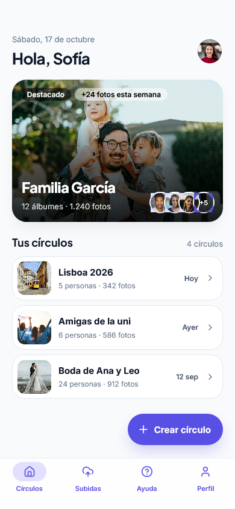

### Mis círculos · escritorio

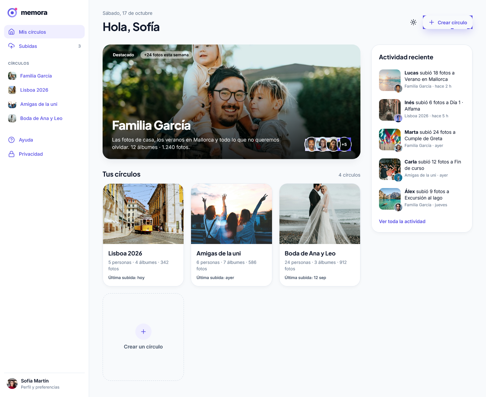

### Álbum · escritorio · selección múltiple

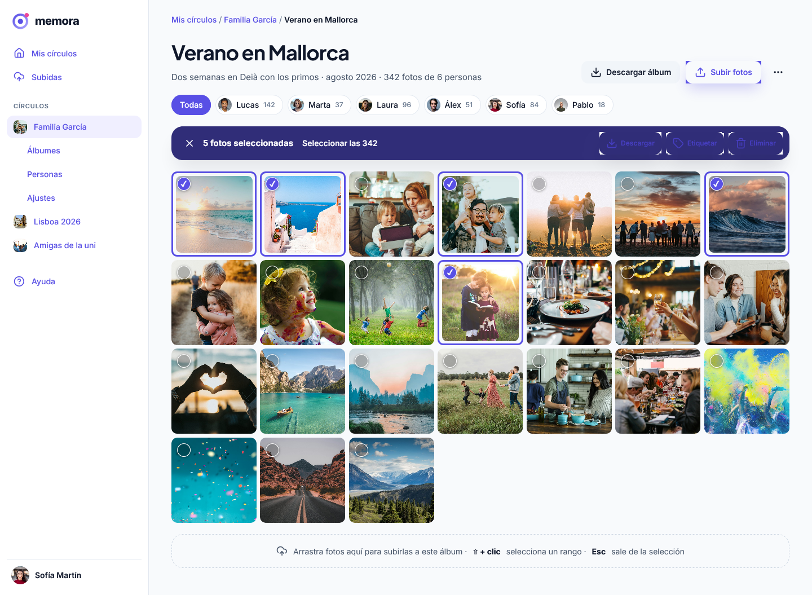

### Foto · móvil

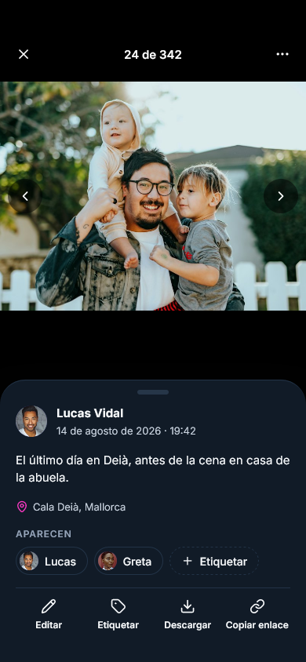

### Foto · escritorio · modal

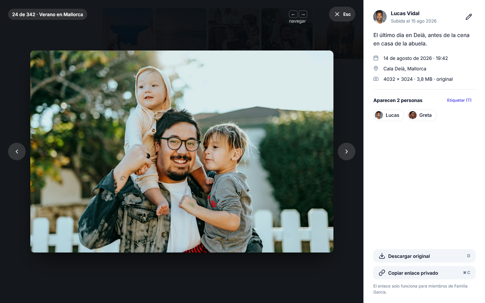

### Acceso · móvil

### Registro · escritorio · errores

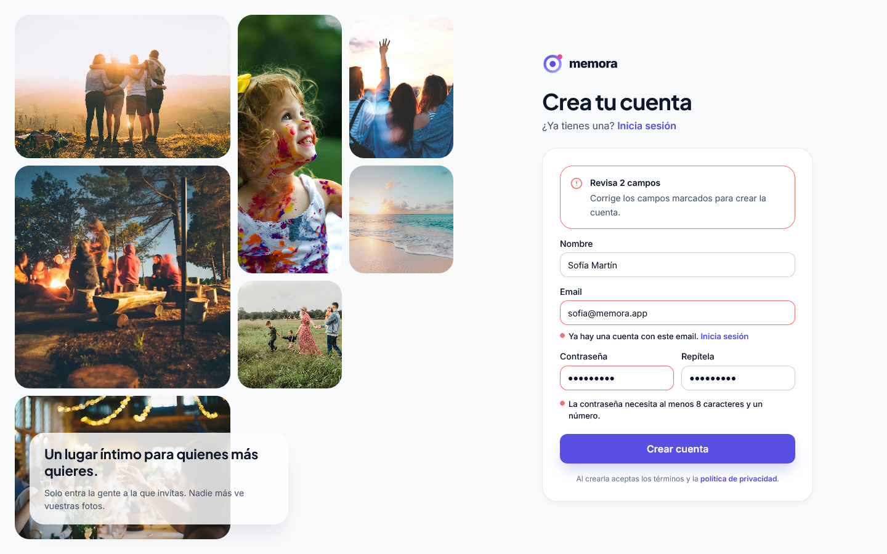

### Invitación · móvil

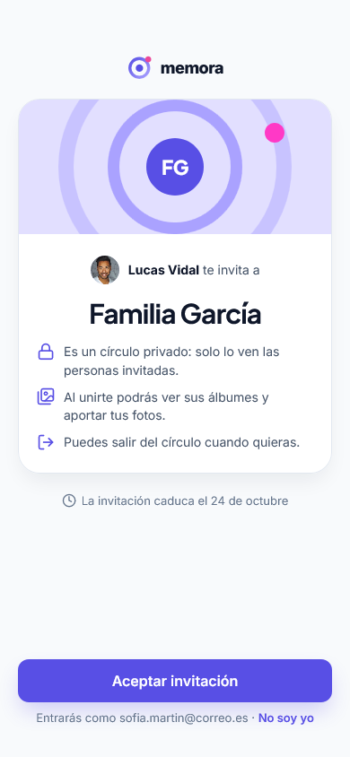

### Personas · móvil

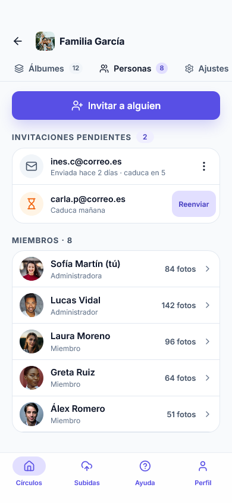

### Ajustes · escritorio · guardando

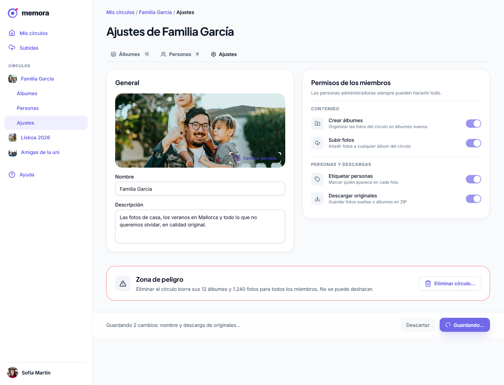

### Perfil · móvil

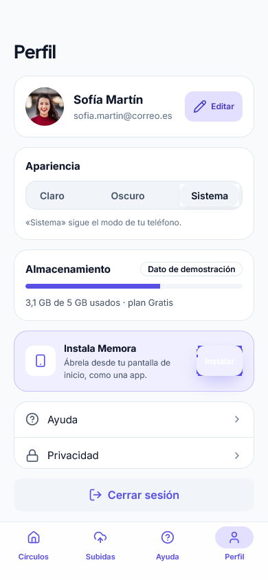

### Ayuda · móvil

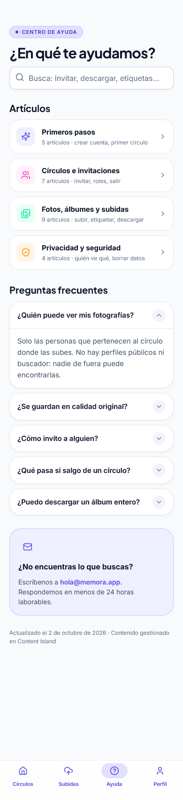

### Privacidad · escritorio

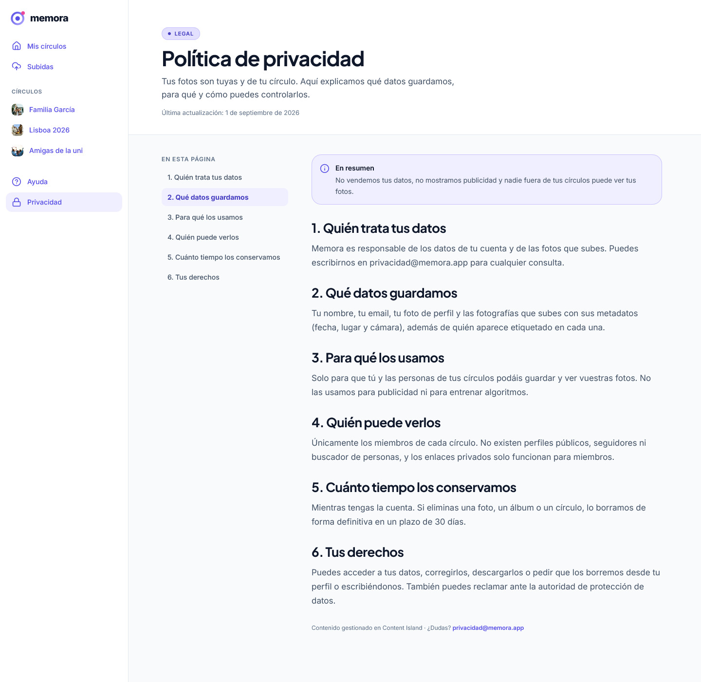

### No encontrada · móvil

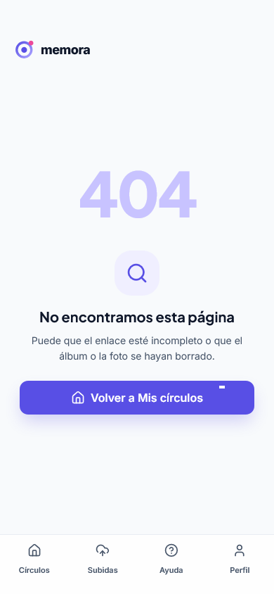

### Cola de subida · móvil

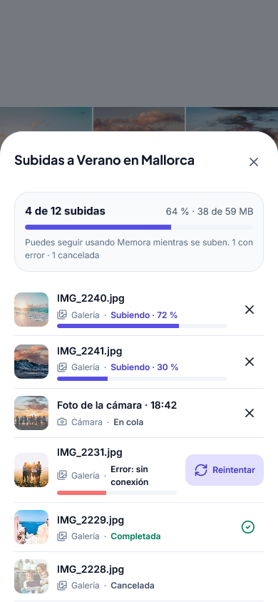

## Diseño inferido

La segunda iteración no incluye algunas vistas base o variantes. Se construirán con los tokens y patrones existentes, y se marcarán como **inferidas** hasta que exista un PNG canónico:

| Vista | Referencia de partida |
| --- | --- |
| Registro · estado base | `Acceso · móvil` + `Registro · móvil · teclado abierto` + `Registro · escritorio · errores` |
| Crear círculo · estado base | `Crear círculo · móvil · validación` + formularios de Ajustes |
| Crear álbum · estado base | `Crear álbum · móvil · guardando` + formularios de Ajustes |
| Álbum · móvil · estado normal | `Álbum · móvil · vacío` + `Álbum · móvil · subiendo` + `Álbum · escritorio · selección múltiple` |
| Acceso · escritorio · estado base | `Acceso · escritorio · enviando` |
| Etiquetar · escritorio · estado base | `Etiquetar · escritorio · guardando` + `Etiquetar · móvil` |
| Ajustes · escritorio · estado base | `Ajustes · escritorio · guardando` + `Ajustes · móvil` |
| Perfil · escritorio · éxito | `Perfil · escritorio · edición con error` + `Perfil · móvil` |
| Actividad · panel y página | Panel de `Mis círculos · escritorio` + lista/tarjetas del sistema |
| Variantes oscuras | `Álbum · escritorio · oscuro · subidas y soltar` + tokens oscuros |

Regla: toda vista inferida se revisa con `design-auditor` y se anota en la spec de su feature. No se presenta como diseño canónico.
